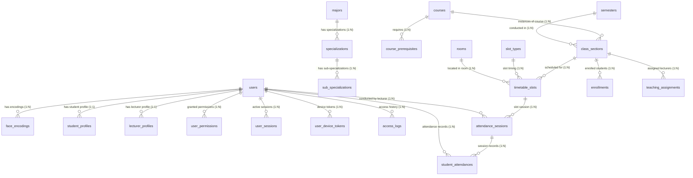

# UNICHECK - SCHEMA MAP & ERD (50 BẢNG CSDL)

Tài liệu này tổng hợp cấu trúc chi tiết của toàn bộ **50 bảng** cơ sở dữ liệu hệ thống UniCheck qua các migration V1–V3, đồng thời đánh dấu chi tiết 4 bảng trọng yếu phục vụ điểm danh và nhận diện sinh trắc học.

---

## 1. BIỂU ĐỒ QUAN HỆ THỰC THỂ (ERD DIAGRAM)

---

## 2. KHẢO SÁT CHI TIẾT 4 BẢNG TRỌNG TÂM (CORE ATTENDANCE & BIOMETRIC TABLES)

### 2.1. Bảng `face_encodings` (Lưu trữ Vector đặc trưng khuôn mặt)
- **Vị trí**: Migration V2 ([`V2__init_users_and_profiles.sql:L103-L114`](file:///c:/Users/Admin/Documents/Antigravity/UniCheck/backend/src/main/resources/db/migration/V2__init_users_and_profiles.sql#L103-L114))
- **JPA Entity Mapping**: [`FaceEncoding.java`](file:///c:/Users/Admin/Documents/Antigravity/UniCheck/backend/src/main/java/com/unicheck/model/entity/FaceEncoding.java) (`@Entity @Table(name = "face_encodings")`)
- **Cấu trúc cột thực tế**:
  - `id` (`BIGSERIAL PRIMARY KEY`): Định danh duy nhất.
  - `user_id` (`BIGINT NOT NULL REFERENCES users(id) ON DELETE CASCADE`): Khóa ngoại liên kết người dùng.
  - `encoding_data` (`BYTEA NOT NULL`): Mảng byte chứa vector 128 chiều trích xuất từ khuôn mặt.
  - `registered_at` (`TIMESTAMP NOT NULL DEFAULT CURRENT_TIMESTAMP`): Thời điểm đăng ký khuôn mặt.
  - `liveness_verified` (`BOOLEAN NOT NULL DEFAULT FALSE`): Cờ đánh dấu đã vượt qua bài kiểm tra liveness thật hay chưa.
  - `face_image` (`TEXT`): *Trường dự phòng; tuân thủ nguyên tắc không lưu ảnh khuôn mặt gốc*.
  - `created_at`, `updated_at` (`TIMESTAMP NOT NULL`).
- **Chỉ mục (Indexes)**:
  - `face_encodings_pkey` (PRIMARY KEY, btree `id`)
  - `idx_face_encodings_user_id` (btree `user_id`)

---

### 2.2. Bảng `timetable_slots` (Lịch học / Thời khóa biểu)
- **Vị trí**: Migration V3 ([`V3__init_classes_attendance_and_operations.sql:L49-L62`](file:///c:/Users/Admin/Documents/Antigravity/UniCheck/backend/src/main/resources/db/migration/V3__init_classes_attendance_and_operations.sql#L49-L62))
- **JPA Entity Mapping**: *Chưa có Entity khai báo trong Java*
- **Cấu trúc cột thực tế**:
  - `id` (`BIGSERIAL PRIMARY KEY`): Định danh ca học.
  - `class_name` (`VARCHAR(50) NOT NULL REFERENCES class_sections(class_name) ON DELETE CASCADE`): Tên lớp học phần.
  - `room_id` (`BIGINT REFERENCES rooms(id)`): Phòng học diễn ra tiết.
  - `slot_type_id` (`BIGINT REFERENCES slot_types(id)`): Khung giờ tiết học (tiết 1-3, tiết 4-6...).
  - `date` (`DATE NOT NULL`): Ngày diễn ra buổi học thực tế.
  - `day_of_week` (`INT NOT NULL`): Thứ trong tuần (2 - 8).
  - `slot_number` (`INT NOT NULL`): Số thứ tự ca học trong ngày.
  - `status` (`VARCHAR(20) NOT NULL DEFAULT 'SCHEDULED'`): Trạng thái ca học (`SCHEDULED`, `COMPLETED`, `CANCELLED`).
  - `note` (`VARCHAR(500)`): Ghi chú giảng dạy.
- **Chỉ mục (Indexes)**:
  - `timetable_slots_pkey` (PRIMARY KEY, btree `id`)
  - `idx_timetable_slots_class_name` (btree `class_name`)
  - `idx_timetable_slots_date` (btree `date`)

---

### 2.3. Bảng `attendance_sessions` (Phiên / Buổi điểm danh)
- **Vị trí**: Migration V3 ([`V3__init_classes_attendance_and_operations.sql:L91-L100`](file:///c:/Users/Admin/Documents/Antigravity/UniCheck/backend/src/main/resources/db/migration/V3__init_classes_attendance_and_operations.sql#L91-L100))
- **JPA Entity Mapping**: *Chưa có Entity khai báo trong Java*
- **Cấu trúc cột thực tế**:
  - `id` (`BIGSERIAL PRIMARY KEY`): Định danh buổi điểm danh.
  - `timetable_slot_id` (`BIGINT NOT NULL REFERENCES timetable_slots(id) ON DELETE CASCADE`): Ca học liên kết.
  - `lecturer_id` (`BIGINT REFERENCES users(id)`): Giảng viên phụ trách buổi điểm danh.
  - `opened_at` (`TIMESTAMP NOT NULL DEFAULT CURRENT_TIMESTAMP`): Thời điểm mở cổng điểm danh.
  - `closed_at` (`TIMESTAMP`): Thời điểm đóng phiên điểm danh.
  - `status` (`VARCHAR(20) NOT NULL DEFAULT 'OPEN'`): Trạng thái phiên (`OPEN`, `CLOSED`, `CANCELLED`).
  - `created_at` (`TIMESTAMP NOT NULL`).
- **Chỉ mục (Indexes)**:
  - `attendance_sessions_pkey` (PRIMARY KEY, btree `id`)
- **Khóa ngoại trỏ đến**:
  - `student_attendances.session_id` -> `attendance_sessions.id` ON DELETE CASCADE

---

### 2.4. Bảng `student_attendances` (Nhật ký điểm danh sinh viên - Records)
- **Vị trí**: Migration V3 ([`V3__init_classes_attendance_and_operations.sql:L102-L123`](file:///c:/Users/Admin/Documents/Antigravity/UniCheck/backend/src/main/resources/db/migration/V3__init_classes_attendance_and_operations.sql#L102-L123))
- **JPA Entity Mapping**: *Chưa có Entity khai báo trong Java*
- **Cấu trúc cột thực tế**:
  - `id` (`BIGSERIAL PRIMARY KEY`): Định danh bản ghi điểm danh.
  - `session_id` (`BIGINT NOT NULL REFERENCES attendance_sessions(id) ON DELETE CASCADE`): Buổi điểm danh.
  - `student_id` (`BIGINT NOT NULL REFERENCES users(id)`): Sinh viên điểm danh.
  - `status` (`VARCHAR(20) NOT NULL DEFAULT 'ABSENT'`): Kết quả (`PRESENT`, `ABSENT`, `LATE`, `EXCUSED`).
  - `method` (`VARCHAR(20)`): Phương thức điểm danh (`FACE`, `QR`, `MANUAL`).
  - `check_in_time` (`TIMESTAMP`): Thời điểm sinh viên check-in thành công.
  - `face_confidence` (`DOUBLE PRECISION`): Điểm tin cậy đối sánh vector khuôn mặt.
  - `wifi_bssid` (`VARCHAR(17)`): Địa chỉ MAC BSSID của Access Point phòng học mà sinh viên kết nối.
  - `wifi_rssi` (`INT`): Cường độ tín hiệu Wi-Fi thu được.
  - `attempt_count` (`INT DEFAULT 0`): Số lần thử điểm danh thất bại.
  - `failure_reason` (`VARCHAR(500)`): Lý do điểm danh thất bại.
  - `requires_manual_verify` (`BOOLEAN DEFAULT FALSE`): Cờ yêu cầu giảng viên duyệt tay.
  - `manual_verified_by` (`BIGINT REFERENCES users(id)`): Giảng viên duyệt tay.
  - `manual_verified_at` (`TIMESTAMP`): Thời điểm duyệt tay.
  - `note` (`VARCHAR(500)`): Ghi chú của giảng viên hoặc sinh viên.
  - `created_at`, `updated_at` (`TIMESTAMP NOT NULL`).
- **Chỉ mục (Indexes)**:
  - `student_attendances_pkey` (PRIMARY KEY, btree `id`)
  - `idx_student_attendances_session_id` (btree `session_id`)
  - `idx_student_attendances_student_id` (btree `student_id`)

---

## 3. DANH MỤC TỔNG HỢP 50 BẢNG THEO PHÂN HỆ

### Phân hệ 1: Danh mục học vụ (Academic Catalog - V1 Migration, 16 bảng)
1. `majors`: Ngành học lớn.
2. `specializations`: Chuyên ngành đào tạo.
3. `sub_specializations`: Hướng chuyên sâu.
4. `courses`: Học phần / môn học.
5. `course_prerequisites`: Học phần tiên quyết / học trước.
6. `specialization_courses`: Ma trận học phần thuộc chuyên ngành.
7. `sub_specialization_courses`: Ma trận học phần thuộc hướng chuyên sâu.
8. `semesters`: Học kỳ (Học kỳ 1, 2, hè).
9. `semester_configs`: Cấu hình thời gian đăng ký, giới hạn tín chỉ học kỳ.
10. `semester_weekdays`: Ngày học trong tuần của học kỳ.
11. `holidays`: Danh sách ngày nghỉ lễ theo năm.
12. `slot_types`: Định nghĩa các ca / tiết học tiêu chuẩn.
13. `rooms`: Danh sách phòng học, giảng đường.
14. `wifi_access_points`: Danh sách Access Point Wi-Fi của nhà trường.
15. `room_wifi_access_points`: Bảng liên kết AP Wi-Fi với phòng học cụ thể.
16. `attendance_configs`: Cấu hình quy chế điểm danh toàn trường (ngưỡng vắng, tỷ lệ tối thiểu).

### Phân hệ 2: Người dùng, Hồ sơ & Bảo mật (Users & Security - V2 Migration, 9 bảng)
17. `users`: Tài khoản hệ thống (Đã có `User.java`).
18. `student_profiles`: Hồ sơ sinh viên, niên khóa, GPA (Đã có `StudentProfile.java`).
19. `lecturer_profiles`: Hồ sơ giảng viên, bộ môn, chuyên môn (Đã có `LecturerProfile.java`).
20. `lecturer_grade_otps`: Mã OTP xác thực khóa điểm của giảng viên (Đã có `LecturerGradeOtp.java`).
21. `user_permissions`: Phân quyền chi tiết chức năng (Đã có `UserPermission.java`).
22. `user_device_tokens`: Quản lý FCM Device Token thông báo đẩy (Đã có `UserDeviceToken.java`).
23. `user_sessions`: Quản lý phiên làm việc, thiết bị và IP (Đã có `UserSession.java`).
24. `access_logs`: Nhật ký truy cập, IP, vị trí (Đã có `AccessLog.java`).
25. `face_encodings`: Dữ liệu vector đặc trưng sinh trắc học khuôn mặt (Đã có `FaceEncoding.java`).

### Phân hệ 3: Lớp học phần, Điểm danh & Vận hành (Operations - V3 Migration, 25 bảng)
26. `class_sections`: Lớp học phần mở trong học kỳ.
27. `teaching_assignments`: Phân công giảng viên đứng lớp.
28. `enrollments`: Danh sách sinh viên đăng ký lớp học phần.
29. `timetable_slots`: Lịch học chi tiết từng buổi.
30. `grade_components`: Cấu hình đầu điểm (Chuyên cần, Bài tập, Giữa kỳ, Cuối kỳ).
31. `student_grades`: Bảng điểm chi tiết của từng sinh viên.
32. `attendance_sessions`: Phiên điểm danh từng buổi học.
33. `student_attendances`: Nhật ký điểm danh chi tiết từng sinh viên trong buổi.
34. `assignments`: Bài tập được giảng viên giao cho lớp.
35. `assignment_submissions`: Bài nộp của sinh viên và điểm chấm.
36. `chat_groups`: Nhóm thảo luận trực tuyến của lớp học phần.
37. `chat_group_members`: Thành viên tham gia nhóm chat.
38. `chat_messages`: Nội dung tin nhắn trao đổi trong lớp.
39. `chat_message_reads`: Trạng thái đã xem tin nhắn.
40. `chat_message_reactions`: Thả cảm xúc tin nhắn.
41. `ai_chat_sessions`: Phiên hỏi đáp học tập với trợ lý ảo AI.
42. `ai_chat_messages`: Lịch sử câu hỏi và câu trả lời AI.
43. `notifications`: Thông báo hệ thống gửi đến người dùng.
44. `news`: Bản tin, thông báo học vụ chung của trường.
45. `news_attachments`: Tệp đính kèm bản tin.
46. `academic_requests`: Đơn từ, khiếu nại học vụ của sinh viên.
47. `schedule_requests`: Đơn xin đổi lịch dạy / học bù của giảng viên.
48. `alerts`: Cảnh báo tự động về nguy cơ cấm thi do vắng học quá tỷ lệ.
49. `system_logs`: Nhật ký kiểm toán thao tác hệ thống (Đã có `SystemLog.java`).
50. `import_jobs`: Quản lý các tiến trình import dữ liệu hàng loạt từ Excel/CSV.
