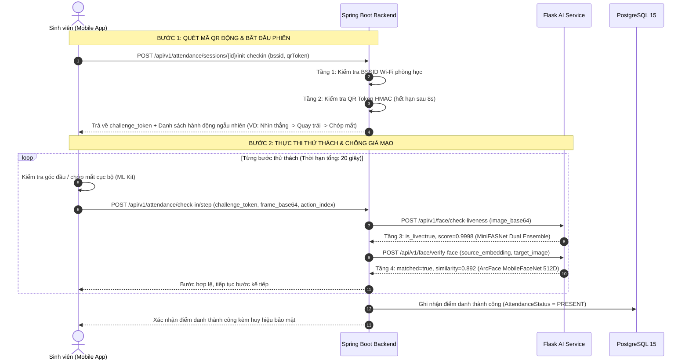
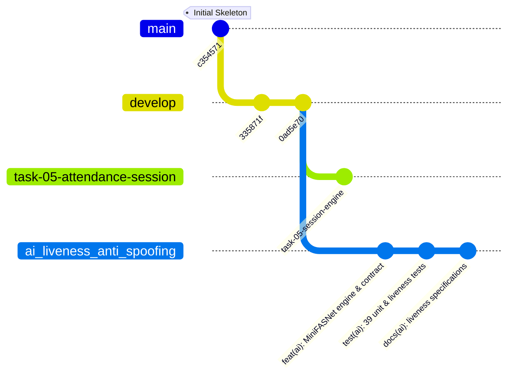

# UniCheck — Kế Hoạch Tích Hợp Chống Giả Mạo Sinh Trắc Học & Giao Thức Thử Thách Động (Liveness Integration & Challenge-Response Protocol Plan)

> **Mã tài liệu:** PLAN-AI-LIVENESS-INTEGRATION-2026  
> **Phiên bản:** 1.0.0 (TASK-08 Real AI Face Liveness & Anti-Spoofing)  
> **Ngày lập:** 18/10/2026  
> **Tác giả:** Senior AI Security Engineer, Software Architect & QA Lead  
> **Trạng thái:** **PROPOSED PATCHES (Sẵn sàng tích hợp sau khi merge độc lập)**  

---

## 1. Phân Tích Thực Trạng & Khoảng Trống Bảo Mật (Security Gap Analysis)

### 1.1. Bài học từ TASK-04 (Head Pose Validation)
Trong TASK-04, UniCheck đã tích hợp thành công giải pháp nhận diện góc quay đầu thời gian thực (**Real Head Pose Validation**) bằng MediaPipe Face Mesh trên Web và Google ML Kit trên Flutter Mobile:
- Xác thực người dùng thực hiện đủ 3 bước: Nhìn thẳng $\rightarrow$ Quay trái $15^\circ$ $\rightarrow$ Quay phải $15^\circ$.
- Ngăn chặn triệt để hiện tượng False Positive (người dùng nhìn thẳng vẫn tự động chuyển bước).

### 1.2. Giới hạn cốt lõi: Tại sao Head Pose KHÔNG PHẢI là Liveness?
> [!CAUTION] NGUYÊN TẮC AN NINH SINH TRẮC HỌC CỐT LÕI
> **Head Pose Validation chỉ xác định góc quay đầu trong không gian 3 chiều; nó KHÔNG chứng minh vật thể trước camera là người thật!**
> 
> Một video quay sẵn trên màn hình iPad/smartphone cũng chứa đầy đủ chuyển động: nhìn thẳng, quay đầu sang trái, quay đầu sang phải. Nếu kẻ tấn công phát lại video này trước webcam/camera, hệ thống Head Pose thuần túy sẽ bị đánh lừa 100%.

Do đó, **TASK-08** cung cấp mảnh ghép phòng thủ thiết yếu: **MiniFASNet AI Anti-Spoofing Engine** để thẩm định bản chất quang học của bề mặt khuôn mặt (da thật vs màn hình LED/OLED/giấy in).

---

## 2. Kiến Trúc Xác Thực 4 Tầng Toàn Diện (4-Tier Verification Architecture)

Khi tích hợp đầy đủ vào quy trình Điểm Danh Sinh Viên (TASK-07 / TASK-08), hệ thống áp dụng cơ chế bảo vệ 4 tầng không thể vượt qua:



---

## 3. Giao Thức Thử Thách - Phản Hồi Động Chống Video Replay (Dynamic Challenge-Response)

Để chống lại các đoạn video phát lại tinh vi nhất:
1. **Thứ tự hành động hoàn toàn ngẫu nhiên do Server chỉ định:**
   - Server sinh ngẫu nhiên 2-3 hành động từ tập hợp: `LOOK_STRAIGHT`, `TURN_LEFT_15`, `TURN_RIGHT_15`, `BLINK_EYES`, `SMILE`.
   - Chuỗi này không lặp lại giữa các lần điểm danh. Kẻ gian không thể dự đoán trước để chuẩn bị video quay sẵn.
2. **Khóa phiên xác thực (Session Binding):**
   - Chuỗi hành động gắn liền với `challenge_token` (ký bằng HMAC-SHA256 với secret của phiên điểm danh).
   - `TTL` (Time To Live) ngắn: tối đa **15 - 20 giây**. Quá thời gian, token tự động vô hiệu hóa.
3. **Kiểm tra tính liên tục:**
   - Kiểm tra khoảng cách thời gian giữa các khung hình (Frame Delta Time $\ge 300$ms và $\le 4000$ms).
   - Ngăn chặn việc gửi ảnh tĩnh cùng lúc.

---

## 4. Danh Mục Bản Vá Mã Nguồn Đề Xuất (Proposed Patch Specifications)

> [!NOTE] NGUYÊN TẮC PHẠM VI WORKTREE
> Theo quy tắc triển khai song song độc lập với Agent TASK-05, các tệp Backend/Frontend/Mobile dưới đây **KHÔNG ĐƯỢC PHÉP CHỈNH SỬA TRỰC TIẾP** trong Worktree TASK-08 này. 
> Dưới đây là đặc tả mã nguồn chính xác để kỹ sư tích hợp sau khi merge branch `ai_liveness_anti_spoofing`:

### 4.1. Patch Backend: Bổ sung DTO `AiCheckLivenessResponse.java`
**Đường dẫn:** `backend/src/main/java/com/unicheck/model/dto/ai/AiCheckLivenessResponse.java`
```java
package com.unicheck.model.dto.ai;

import com.fasterxml.jackson.annotation.JsonProperty;
import lombok.AllArgsConstructor;
import lombok.Builder;
import lombok.Data;
import lombok.NoArgsConstructor;

import java.util.Map;

@Data
@Builder
@NoArgsConstructor
@AllArgsConstructor
public class AiCheckLivenessResponse {
    @JsonProperty("is_live")
    private Boolean isLive;

    @JsonProperty("liveness_score")
    private Double livenessScore;

    private Double threshold;

    @JsonProperty("model_name")
    private String modelName;

    @JsonProperty("model_version")
    private String modelVersion;

    private String mode;

    @JsonProperty("face_detected")
    private Boolean faceDetected;

    private Double confidence;

    @JsonProperty("attack_type_detected")
    private String attackTypeDetected;

    private Map<String, Double> probabilities;
}
```

### 4.2. Patch Backend: Bổ sung phương thức vào `AiServiceClient.java`
**Đường dẫn:** `backend/src/main/java/com/unicheck/service/ai/AiServiceClient.java`
```java
public AiCheckLivenessResponse checkLiveness(String imageBase64) {
    String url = aiServiceBaseUrl + "/api/v1/face/check-liveness";
    Map<String, Object> payload = Map.of(
            "image_base64", imageBase64,
            "threshold", 0.70
    );

    try {
        ApiResponse<AiCheckLivenessResponse> response = restClient.post()
                .uri(url)
                .contentType(MediaType.APPLICATION_JSON)
                .body(payload)
                .retrieve()
                .body(new ParameterizedTypeReference<ApiResponse<AiCheckLivenessResponse>>() {});

        if (response != null && response.getData() != null) {
            return response.getData();
        }
        throw new AppException(ErrorCode.AI_SERVICE_UNAVAILABLE, "Không nhận được dữ liệu phản hồi từ mô hình liveness");
    } catch (HttpClientErrorException ex) {
        log.error("AI Service từ chối kiểm tra liveness: HTTP {} - {}", ex.getStatusCode(), ex.getResponseBodyAsString());
        throw new AppException(ErrorCode.FACE_DETECTION_FAILED, "Ảnh không đạt chuẩn sinh trắc học hoặc có nhiều khuôn mặt");
    } catch (Exception ex) {
        log.error("Lỗi kết nối tới AI Service liveness endpoint: {}", ex.getMessage());
        throw new AppException(ErrorCode.AI_SERVICE_UNAVAILABLE, "Dịch vụ chống giả mạo khuôn mặt tạm thời gián đoạn (Fail-Closed)");
    }
}
```

### 4.3. Patch Backend: Kích hoạt `liveness_verified = true` trong `FaceEnrollmentServiceImpl.java`
**Đường dẫn:** `backend/src/main/java/com/unicheck/service/impl/FaceEnrollmentServiceImpl.java`
```java
// THAY THẾ DÒNG 91-92 HIỆN TẠI:
// faceEncoding.setLivenessVerified(false);

// BẰNG ĐOẠN CODE KIỂM TRA LIVENESS THẬT:
AiCheckLivenessResponse livenessResult = aiServiceClient.checkLiveness(request.getImageBase64());
if (Boolean.FALSE.equals(livenessResult.getIsLive())) {
    log.warn("Đăng ký khuôn mặt thất bại: Phát hiện giả mạo {} với điểm số {}", 
            livenessResult.getAttackTypeDetected(), livenessResult.getLivenessScore());
    throw new AppException(ErrorCode.FACE_VERIFICATION_FAILED, 
            "Phát hiện dấu hiệu giả mạo sinh trắc học (Ảnh in hoặc phát lại trên màn hình)");
}

faceEncoding.setLivenessVerified(true);
```

### 4.4. Patch Frontend: Cập nhật thông điệp bảo mật `FaceRegistrationPage.tsx`
**Đường dẫn:** `frontend/src/pages/student/FaceRegistrationPage.tsx`
- Thay thế nhãn thông báo tĩnh:
  - *Trước:* `"Passive Frame Analysis (Chưa xác nhận Anti-Spoofing MiniFASNet)"`
  - *Sau:* `"Bảo vệ bởi MiniFASNet AI Anti-Spoofing Engine (Dual Model V2 + V1SE Active)"`

---

## 5. Quy Trình Merge An Toàn Với TASK-05 (Safe Integration Workflow)



### Các bước khuyến nghị khi hoàn thành TASK-05:
1. Agent TASK-05 hoàn tất commit và kiểm thử tính năng Attendance Sessions trên nhánh của TASK-05.
2. Kiểm tra `git diff --stat develop...ai_liveness_anti_spoofing` để đảm bảo Worktree TASK-08 chỉ tác động đến:
   - `ai-service/**`
   - `docs/ai/**`
   - `docs/testing/TASK_08_*.md`
3. Thực hiện merge nhánh `ai_liveness_anti_spoofing` vào `develop`.
4. Áp dụng bản vá Spring Boot `AiServiceClient` và kích hoạt `liveness_verified=true` trong môi trường dev staging.
5. Chạy bộ kiểm thử toàn hệ thống (Spring Boot + Flask AI Service) để nghiệm thu trọn vẹn.
