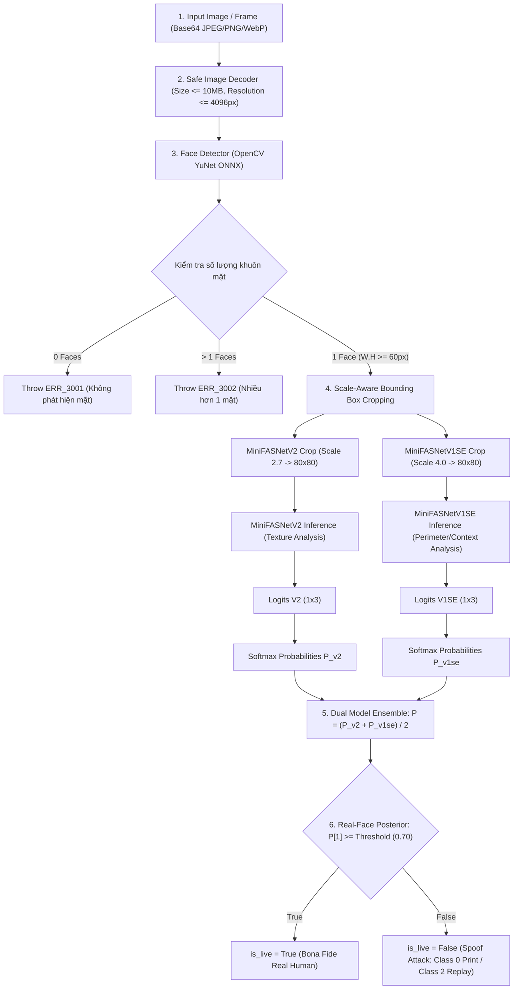

# UniCheck — Đặc Tả Kỹ Thuật Mô Hình Chống Giả Mạo Khuôn Mặt (Face Anti-Spoofing Specification)

> **Mã tài liệu:** SPEC-AI-LIVENESS-MODEL-2026  
> **Phiên bản:** 1.0.0 (TASK-08 Real AI Face Liveness & Anti-Spoofing Engine)  
> **Ngày lập:** 18/10/2026  
> **Tác giả:** Senior AI Security Engineer, Computer Vision Engineer & Software Architect  
> **Trạng thái:** **ACTIVE (Triển khai thực tế trên CPU với ONNX Runtime)**  

---

## 1. Tổng Quan Kiến Trúc Pipeline Chống Giả Mạo (Anti-Spoofing Pipeline)

Module AI Liveness & Anti-Spoofing của UniCheck bảo vệ hệ thống điểm danh trước các hành vi gian lận sinh trắc học (Presentation Attacks - PA) theo tiêu chuẩn **ISO/IEC 30107**:



---

## 2. Lựa Chọn & Đặc Tả Mô Hình AI (Model Selection & Provenance)

### 2.1. Danh mục mô hình MiniFASNet được chọn

Để đáp ứng các yêu cầu khắt khe: **CPU inference $\le 20$ms**, **không phụ thuộc GPU**, **giấy phép bản quyền thương mại rõ ràng**, **tệp trọng số xác thực được checksum**, UniCheck triển khai kiến trúc đa mô hình **MiniFASNet (Silent-Face-Anti-Spoofing)**:

| Thuộc tính | Mô hình 1: MiniFASNetV2 | Mô hình 2: MiniFASNetV1SE |
| :--- | :--- | :--- |
| **Vai trò** | Phân tích vi vân bề mặt cục bộ (Local Texture) | Phân tích bối cảnh & viền biên (Global Context) |
| **Tác giả gốc** | Minivision AI Team | Minivision AI Team |
| **Chuyển đổi ONNX** | Yakhyo (`face-anti-spoofing`) | Yakhyo (`face-anti-spoofing`) |
| **Giấy phép mã nguồn** | **Apache License 2.0** | **Apache License 2.0** |
| **Giấy phép trọng số** | **Apache License 2.0** (Open weights) | **Apache License 2.0** (Open weights) |
| **Đường dẫn tệp** | `ai-service/models/MiniFASNetV2.onnx` | `ai-service/models/MiniFASNetV1SE.onnx` |
| **Kích thước tệp** | 1,743,581 bytes (~1.66 MB) | 1,742,335 bytes (~1.66 MB) |
| **Mã băm SHA-256** | `b32929adc2d9c34b9486f8c4c7bc97c1b69bc0ea9befefc380e4faae4e463907` | `ebab7f90c7833fbccd46d3a555410e78d969db5438e169b6524be444862b3676` |
| **Hệ số tỷ lệ cắt (Scale)** | $2.7 \times \text{bbox}$ (Vùng mặt cận cảnh) | $4.0 \times \text{bbox}$ (Vùng mặt kèm khung viền) |
| **Kích thước đầu vào** | `[1, 3, 80, 80]`, `float32`, layout NCHW | `[1, 3, 80, 80]`, `float32`, layout NCHW |
| **Kích thước đầu ra** | `[1, 3]`, `float32` (Logits 3 lớp) | `[1, 3]`, `float32` (Logits 3 lớp) |
| **Thời gian chạy CPU** | **1.14 ms** (p50: 1.10ms) | **1.23 ms** (p50: 1.23ms) |

### 2.2. Kiến trúc mạng nơ-ron sâu (Neural Architecture)
- **MiniFASNet (Mini Face Anti-Spoofing Network):**
  - Sử dụng **Depthwise Separable Convolutions** giúp giảm số lượng tham số xuống dưới 0.45M tham số (parameters), cho phép suy luận thời gian thực trên CPU thông thường mà không cần phần cứng tăng tốc GPU.
  - **Squeeze-and-Excitation (SE Blocks) trong V1SE:** Tự động tái hiệu chuẩn độ quan trọng của từng kênh đặc trưng (channel-wise feature responses), tăng cường khả năng phát hiện độ bóng, phản chiếu ánh sáng và cạnh viền màn hình/giấy in.

---

## 3. Thuật Toán Cắt Vùng Mặt Theo Tỷ Lệ (Scale-Aware Face Cropping)

Thuật toán cắt vùng mặt mở rộng giữ tâm khuôn mặt và co giãn đều đặn theo tỷ lệ `scale` ($2.7$ hoặc $4.0$), đồng thời giới hạn tọa độ an toàn trong biên ảnh nguồn $[0, W-1] \times [0, H-1]$:

```python
def get_scaled_bounding_box(src_w, src_h, bbox, scale):
    x, y, box_w, box_h = bbox
    max_scale = min((src_h - 1) / box_h, (src_w - 1) / box_w, scale)
    new_w = box_w * max_scale
    new_h = box_h * max_scale

    center_x = x + box_w / 2.0
    center_y = y + box_h / 2.0

    left_top_x = center_x - new_w / 2.0
    left_top_y = center_y - new_h / 2.0
    right_bottom_x = center_x + new_w / 2.0
    right_bottom_y = center_y + new_h / 2.0

    # Trượt bù trừ nếu viền vượt quá khung ảnh
    if left_top_x < 0:
        right_bottom_x -= left_top_x
        left_top_x = 0
    if left_top_y < 0:
        right_bottom_y -= left_top_y
        left_top_y = 0
    if right_bottom_x > src_w - 1:
        left_top_x -= (right_bottom_x - src_w + 1)
        right_bottom_x = src_w - 1
    if right_bottom_y > src_h - 1:
        left_top_y -= (right_bottom_y - src_h + 1)
        right_bottom_y = src_h - 1

    return int(round(left_top_x)), int(round(left_top_y)), int(round(right_bottom_x)), int(round(right_bottom_y))
```

---

## 4. Đặc Tả Đầu Ra & Giải Thích Xác Suất Hậu Nghiệm (Posterior Probability)

Đầu ra của mô hình gồm 3 nút logit tương ứng với 3 lớp mục tiêu:

$$\mathbf{z} = [z_0, z_1, z_2]$$

Hàm Softmax tính toán phân phối xác suất hợp lệ:

$$P(C_i) = \frac{e^{z_i - \max(\mathbf{z})}}{\sum_{j=0}^2 e^{z_j - \max(\mathbf{z})}}, \quad \sum_{i=0}^2 P(C_i) = 1.0$$

### Ý nghĩa các lớp:
- **Lớp 0 ($C_0$ — `print_paper`):** Tấn công ảnh in 2D (giấy thường, giấy ảnh bóng, mặt nạ giấy cắt khoét mắt).
- **Lớp 1 ($C_1$ — `real`):** Khuôn mặt thực thể người sống (Bona Fide Presentation).
- **Lớp 2 ($C_2$ — `screen_replay`):** Tấn công phát lại trên màn hình số (màn hình điện thoại AMOLED/LCD, máy tính bảng, màn hình laptop/PC).

### Quyết định thực thể (Liveness Decision):
Hệ thống sử dụng xác suất của Lớp 1 làm điểm số thực thể:

$$\text{liveness\_score} = P(C_1)$$

Quy tắc quyết định:
$$\text{is\_live} = \begin{cases} \text{True} & \text{khi } \text{liveness\_score} \ge \theta \\ \text{False} & \text{khi } \text{liveness\_score} < \theta \end{cases}$$

Ngưỡng mặc định: $\theta = 0.70$ (cấu hình động qua biến môi trường `AI_LIVENESS_THRESHOLD`).

Khi $\text{is\_live} = \text{False}$, hệ thống xác định loại tấn công nghi vấn:
$$\text{attack\_type} = \begin{cases} \text{"PRINT\_PAPER\_OR\_CUTOUT"} & \text{khi } P(C_0) \ge P(C_2) \\ \text{"SCREEN\_OR\_VIDEO\_REPLAY"} & \text{khi } P(C_2) > P(C_0) \end{cases}$$

---

## 5. Phạm Vi Bảo Vệ & Giới Hạn Của Mô Hình (Threat Model & Limitations)

> [!WARNING] CẢNH BÁO BẢO MẬT & GIỚI HẠN KỸ THUẬT QUAN TRỌNG
> Mô hình MiniFASNet là giải pháp **Chống giả mạo thụ động trên khung hình đơn (Single-Frame Passive Anti-Spoofing)**. 
> UniCheck cam kết minh bạch về năng lực phòng vệ và giới hạn thực nghiệm:

### 5.1. Các dạng tấn công ĐƯỢC CHỨNG MINH ngăn chặn hiệu quả
1. **Ảnh in 2D (Printed Photo Attacks):**
   - Ảnh chụp chân dung in trên giấy A4 trắng đen hoặc in màu chất lượng cao.
   - Ảnh in bị cắt lỗ mắt/miệng để giả lập cử động.
   - Ảnh chụp trên màn hình điện thoại chụp lại qua camera.
2. **Phát lại màn hình tĩnh (Static Screen Replay):**
   - Đưa smartphone, iPad hoặc màn hình máy tính hiển thị ảnh tĩnh của sinh viên trước ống kính camera.
   - Phát hiện các hiệu ứng quang học đặc thù: Moire pattern (vân giao thoa màn hình), độ chói phản xạ đèn LED/OLED, độ sâu trường ảnh phi tự nhiên.

### 5.2. Các dạng tấn công CHƯA ĐƯỢC CHỨNG MINH phòng vệ (Cần biện pháp bổ trợ)
1. **Tấn công phát lại video chuyển động (Video Replay Attacks with Authentic Motion):**
   - Nếu kẻ gian phát video quay sẵn người thật cử động mắt/đầu trên màn hình 4K/OLED chất lượng cao với góc quay và ánh sáng tự nhiên, mô hình trên 1 khung hình có thể bị nhầm lẫn.
   - **Giải pháp bắt buộc:** Kết hợp với **Thử thách - Phản hồi động (Randomized Interactive Challenge-Response)** quy định tại `LIVENESS_INTEGRATION_PLAN.md`.
2. **Mặt nạ 3D tinh xảo (3D Hyper-Realistic Silicone/Latex Masks):**
   - Mô hình huấn luyện trên dữ liệu 2D print/replay; chưa có đánh giá thực nghiệm trên các loại mặt nạ silicon y tế chuyên dụng.
3. **Deepfake thời gian thực & Chèn luồng camera ảo (Real-time Generative Face Swap & Virtual Webcam Injection):**
   - Kẻ tấn công can thiệp vào tầng hệ điều hành hoặc trình điều khiển webcam ảo (`OBS Virtual Camera`, `v4l2loopback`) để inject luồng deepfake.
   - **Giải pháp:** Cần kiểm tra chữ ký phần cứng camera tại tầng ứng dụng di động Flutter/WebRTC trước khi gửi ảnh về backend.
