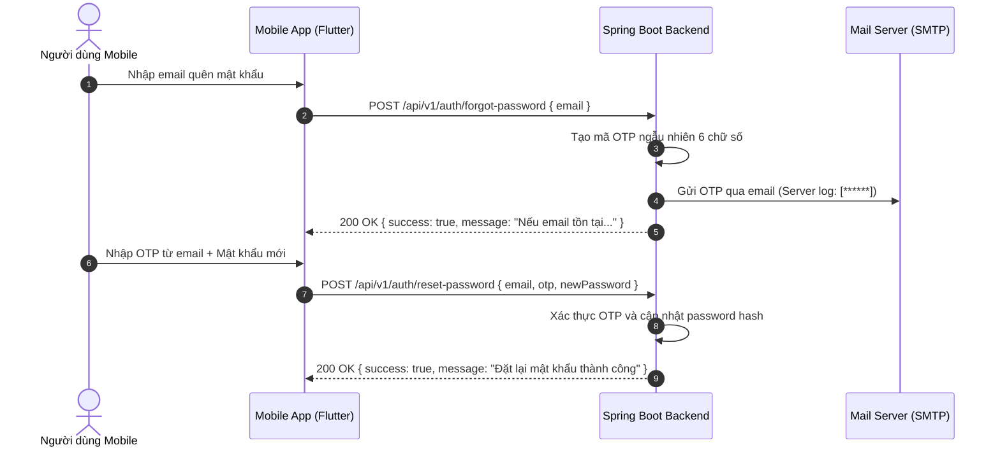

# UniCheck Auth & User Management API Contract (Frozen v1.0.0)

> **Status:** FROZEN & ACTIVE  
> **Date:** 2026-10-13  
> **Target Consumer:** Flutter Mobile / Web / Desktop (`mobile/`)  
> **Reference Specs:** [docs/api/openapi.yaml](file:///c:/Users/Admin/Documents/Antigravity/UniCheck/docs/api/openapi.yaml)

---

## 1. Mục Đích và Phạm Vi (Scope)

Tài liệu này xác lập hợp đồng giao tiếp chuẩn (Single Source of Truth - SSOT) cho toàn bộ hệ thống xác thực (Authentication), phiên làm việc (Session Management) và quản lý người dùng (User Management) của **UniCheck**.

- **Frontend duy nhất đang phát triển:** Ứng dụng Flutter/Dart trong thư mục [`mobile/`](file:///c:/Users/Admin/Documents/Antigravity/UniCheck/mobile).
- **Frontend React cũ (`frontend/`):** Đã đóng băng (legacy), chỉ dùng đối chiếu lịch sử. Không phát triển mới hoặc phụ thuộc vào mock store của React.
- **Backend:** Spring Boot 3.3.4 (Java 21), PostgreSQL 15/18, Redis 7, Spring Security 6 với JWT Filter & Token Redis Service.

---

## 2. Chính Sách Định Tuyến (Route Policy)

Hệ thống hỗ trợ 2 tiền tố đường dẫn thông qua bộ điều khiển kép (Dual-mapping):

| Tiền tố | Vai trò | Trạng thái | Khuyến nghị cho Mobile |
| :--- | :--- | :--- | :--- |
| `/api/v1/...` | **Canonical Standard** | Chính thức, bền vững | **BẮT BUỘC** dùng cho mọi request từ Flutter client mới |
| `/api/...` | **Legacy Alias** | Tương thích ngược 100% | Giữ nguyên cho các tích hợp cũ, test tự động bảo đảm chạy song song |

> **Cam kết tương thích:** Bất kỳ thay đổi nào trên `/api/v1/auth/...` đều có hiệu lực tương đương và trả về cấu trúc JSON giống 100% trên `/api/auth/...`.

---

## 3. Cấu Trúc Envelope Chuẩn (Response Envelope)

Mọi phản hồi từ backend UniCheck đều tuân thủ khuôn mẫu cố định:

### 3.1. Envelope Thường (`ApiResponse<T>`)

```json
{
  "success": true,
  "data": { ... },
  "message": "Thông điệp mô tả kết quả (tiếng Việt)",
  "errorCode": null
}
```

Khi có lỗi:
```json
{
  "success": false,
  "data": null,
  "message": "Tên đăng nhập hoặc mật khẩu không chính xác",
  "errorCode": "ERR_2002"
}
```

### 3.2. Envelope Phân Trang (`ApiResponse<PageResponse<T>>`)

```json
{
  "success": true,
  "data": {
    "content": [ ... ],
    "pageNumber": 0,
    "pageSize": 20,
    "totalElements": 105,
    "totalPages": 6,
    "isFirst": true,
    "isLast": false
  },
  "message": "Lấy danh sách người dùng thành công",
  "errorCode": null
}
```

---

## 4. Hợp Đồng Đăng Nhập Phẳng (Flat Login Response Contract)

> [!CAUTION]
> **CẢNH BÁO CHO MOBILE DEVELOPER:**  
> Dữ liệu đăng nhập trả về ở dạng **PHẲNG** (Flat schema). Các trường thông tin người dùng (`userId`, `code`, `username`, `fullName`, `email`, `role`, `isPasswordChanged`) nằm **trực tiếp** trong `data`.  
> **TUYỆT ĐỐI KHÔNG** parse dạng `data.user.id` hay `data.user.username` (đây là lỗi mock cũ trong React legacy).

### 4.1. Request: `POST /api/v1/auth/login` (hoặc `/api/auth/login`)

**Headers:**
```http
Content-Type: application/json
User-Agent: UniCheck-Flutter/1.0.0 (Android 14; Pixel 7)
X-Device-Id: d8a7c2e1-4b3f-4e92-bc20-721389e1a123
```

**Body:**
```json
{
  "username": "student_01",
  "password": "Student@123"
}
```

### 4.2. Response Thành Công (HTTP 200 OK):

```json
{
  "success": true,
  "data": {
    "token": "eyJhbGciOiJIUzI1NiJ9.eyJzdWIiOiJzdHVkZW50XzAxIiwidXNlcklkIjoxMDEsInJvbGUiOiJTVFVERU5UIiwidHlwZSI6ImFjY2VzcyIsImlhdCI6MTc4OTAwMDAwMCwiZXhwIjoxNzg5MDg2NDAwfQ.xyz...",
    "refreshToken": "6b2a0c4f-9e7d-41a2-8e1f-d748f2a1b9c3",
    "tokenType": "Bearer",
    "expiresIn": 900,
    "userId": 101,
    "code": "SV20260001",
    "username": "student_01",
    "fullName": "Nguyễn Văn Sinh Viên",
    "email": "student01@unicheck.edu.vn",
    "role": "STUDENT",
    "isPasswordChanged": true
  },
  "message": "Đăng nhập thành công",
  "errorCode": null
}
```

---

## 5. Vòng Đời Token và Quản Lý Session

### 5.1. Phân Biệt Token Types

| Tiêu chí | Access Token | Refresh Token |
| :--- | :--- | :--- |
| **Claim `type`** | `"access"` | `"refresh"` |
| **Thời hạn** | 15 phút (900 giây) | 7 ngày (604,800 giây) |
| **Vị trí lưu trữ** | Bộ nhớ an toàn điện thoại (`flutter_secure_storage`) | Bộ nhớ an toàn điện thoại (`flutter_secure_storage`) |
| **Cách sử dụng** | Header `Authorization: Bearer <token>` | Body JSON `{ "refreshToken": "..." }` |
| **Giới hạn** | Dùng gọi tất cả API nghiệp vụ | **CHỈ DÙNG** cho endpoint `/refresh-token` |

> [!IMPORTANT]
> **Quy Tắc An Ninh (P02 Enforced):**  
> Nếu client gửi Refresh Token vào Header `Authorization: Bearer <refreshToken>` để gọi `/api/v1/auth/me` hoặc bất kỳ API nghiệp vụ nào, hệ thống sẽ **từ chối ngay lập tức với HTTP 401 Unauthorized (`ERR_2000`)**.

### 5.2. Làm Mới Token (Refresh Token Rotation - RTR)

- **Endpoint:** `POST /api/v1/auth/refresh-token` (hoặc `/api/auth/refresh-token`)
- **Request Body:**
  ```json
  {
    "refreshToken": "6b2a0c4f-9e7d-41a2-8e1f-d748f2a1b9c3"
  }
  ```
- **Response HTTP 200 OK:**
  ```json
  {
    "success": true,
    "data": {
      "token": "eyJhbGciOiJIUzI1NiJ9.new_access_token...",
      "refreshToken": "a1c2d3e4-f5a6-7b8c-9d0e-1f2a3b4c5d6e",
      "tokenType": "Bearer",
      "expiresIn": 900
    },
    "message": "Làm mới mã xác thực thành công",
    "errorCode": null
  }
  ```
- **Chống gian lận (Reuse Detection):** Nếu một Refresh Token đã bị thu hồi/đã dùng mà bị gửi lại lần thứ hai, toàn bộ phiên của người dùng trên thiết bị đó sẽ bị hủy lập tức.

### 5.3. Đăng Xuất (Logout Cô Lập Thiết Bị)

- **Endpoint:** `POST /api/v1/auth/logout` (hoặc `/api/auth/logout`)
- **Headers:** `Authorization: Bearer <access_token>`
- **Cơ chế:** Hệ thống thu hồi Access Token và khóa session tương ứng trong Redis (hoặc local fallback cache). Các thiết bị khác của cùng tài khoản **không bị ảnh hưởng** trừ khi có hành vi vi phạm an ninh.

---

## 6. Hồ Sơ Người Dùng (Profile & Self-Service)

### 6.1. Lấy Hồ Sơ: `GET /api/v1/auth/me` (hoặc `/profile`)

**Headers:** `Authorization: Bearer <access_token>`

**Response HTTP 200 OK:**
```json
{
  "success": true,
  "data": {
    "id": 101,
    "code": "SV20260001",
    "username": "student_01",
    "fullName": "Nguyễn Văn Sinh Viên",
    "email": "student01@unicheck.edu.vn",
    "dob": "2003-05-15",
    "phone": "0901234567",
    "sex": "NAM",
    "role": "STUDENT",
    "status": "ACTIVE",
    "faceDataStatus": "ACTIVE",
    "avatar": "https://storage.unicheck.edu.vn/avatars/user_101.jpg",
    "isPasswordChanged": true,
    "createdAt": "2026-09-01T08:00:00",
    "studentCourse": "K18",
    "gpa": 3.45,
    "majorId": 1,
    "specializationId": 2,
    "subSpecializationId": 3,
    "department": null,
    "expertise": null,
    "bio": null,
    "permissions": [
      "ATTENDANCE_CHECKIN",
      "VIEW_TIMETABLE",
      "VIEW_HISTORY"
    ]
  },
  "message": "Lấy thông tin hồ sơ thành công",
  "errorCode": null
}
```

### 6.2. Cập Nhật Hồ Sơ: `PUT /api/v1/auth/profile`

**Body:**
```json
{
  "fullName": "Nguyễn Văn Sinh Viên",
  "phone": "0987654321",
  "dob": "2003-05-15",
  "sex": "NAM",
  "avatar": "https://storage.unicheck.edu.vn/avatars/new_101.jpg"
}
```

### 6.3. Đổi Mật Khẩu: `POST /api/v1/auth/change-password`

**Body:**
```json
{
  "oldPassword": "Student@123",
  "newPassword": "StudentNewPass@456"
}
```

---

## 7. Khôi Phục Mật Khẩu Qua Email OTP (Password Reset Flow)



---

## 8. Quản Lý Người Dùng Dành Cho ADMIN (`/api/v1/users`)

| Phương thức | Endpoint | Mô tả | Quyền yêu cầu |
| :--- | :--- | :--- | :--- |
| `GET` | `/api/v1/users` | Danh sách người dùng (phân trang, search, lọc role, status) | `ROLE_ADMIN` |
| `POST` | `/api/v1/users` | Tạo mới tài khoản người dùng | `ROLE_ADMIN` |
| `GET` | `/api/v1/users/{id}` | Chi tiết người dùng theo ID | `ROLE_ADMIN` |
| `PUT` | `/api/v1/users/{id}` | Cập nhật thông tin người dùng theo ID | `ROLE_ADMIN` |
| `DELETE` | `/api/v1/users/{id}` | Xóa tài khoản người dùng theo ID | `ROLE_ADMIN` |
| `GET` | `/api/v1/users/active` | Danh sách tài khoản đã kích hoạt (`ACTIVE`) | `ROLE_ADMIN` |
| `GET` | `/api/v1/users/inactive` | Danh sách tài khoản chưa kích hoạt (`INACTIVE`) | `ROLE_ADMIN` |

---

## 9. Danh Mục Mã Lỗi Toàn Hệ Thống (ErrorCode Dictionary)

| Mã lỗi (Code) | Tên Enum | HTTP Status | Mô tả chi tiết |
| :--- | :--- | :--- | :--- |
| `ERR_1000` | `INTERNAL_SERVER_ERROR` | 500 | Lỗi hệ thống máy chủ nội bộ |
| `ERR_1001` | `INVALID_REQUEST` | 400 | Dữ liệu gửi lên không hợp lệ (Validation error) |
| `ERR_1002` | `RESOURCE_NOT_FOUND` | 404 | Không tìm thấy tài nguyên yêu cầu |
| `ERR_1003` | `METHOD_NOT_ALLOWED` | 405 | Phương thức HTTP không được hỗ trợ |
| `ERR_2000` | `UNAUTHORIZED` | 401 | Yêu cầu đăng nhập hoặc phiên làm việc đã hết hạn |
| `ERR_2001` | `FORBIDDEN` | 403 | Bạn không có quyền truy cập chức năng này |
| `ERR_2002` | `INVALID_CREDENTIALS` | 401 | Tên đăng nhập hoặc mật khẩu không chính xác |
| `ERR_2003` | `ACCOUNT_LOCKED` | 403 | Tài khoản hiện đang bị khóa |
| `ERR_2004` | `ACCOUNT_INACTIVE` | 403 | Tài khoản chưa được kích hoạt |
| `ERR_2005` | `TOKEN_EXPIRED` | 401 | Mã xác thực JWT đã hết hạn |
| `ERR_2006` | `TOKEN_INVALID` | 401 | Mã xác thực JWT không hợp lệ |
| `ERR_2007` | `RATE_LIMIT_EXCEEDED` | 429 | Quá nhiều lần thử đăng nhập thất bại. Thử lại sau 15 phút |
| `ERR_2008` | `INVALID_OTP` | 400 | Mã xác thực không chính xác hoặc đã hết hạn |
| `ERR_2009` | `PASSWORD_MISMATCH` | 400 | Mật khẩu hiện tại không chính xác |
| `ERR_2010` | `TOKEN_REVOKED` | 401 | Phiên đăng nhập đã bị thu hồi |
| `ERR_2011` | `USER_ALREADY_EXISTS` | 400 | Tên đăng nhập, email hoặc mã định danh đã tồn tại |
| `ERR_3001` | `FACE_NOT_DETECTED` | 400 | Không phát hiện khuôn mặt trong ảnh |
| `ERR_3002` | `MULTIPLE_FACES_DETECTED` | 400 | Phát hiện nhiều hơn một khuôn mặt |
| `ERR_3003` | `FACE_LIVENESS_FAILED` | 400 | Kiểm tra thực thể (liveness) thất bại |
| `ERR_3004` | `FACE_NOT_MATCHED` | 400 | Khuôn mặt không khớp với hồ sơ đã đăng ký |
| `ERR_3005` | `FACE_NOT_REGISTERED` | 400 | Sinh viên chưa đăng ký dữ liệu khuôn mặt |
| `ERR_3006` | `ATTENDANCE_SESSION_CLOSED`| 400 | Ca điểm danh đã kết thúc hoặc chưa mở |
| `ERR_3007` | `ALREADY_CHECKED_IN` | 409 | Bạn đã điểm danh thành công cho ca học này |
| `ERR_3008` | `WIFI_NOT_MATCHED` | 400 | Vị trí Wi-Fi không khớp với phòng học quy định |
| `ERR_4001` | `DUPLICATE_RESOURCE` | 409 | Dữ liệu đã tồn tại trong hệ thống |
| `ERR_4002` | `CLASS_FULL` | 400 | Lớp học đã đạt số lượng tối đa |

---

## 10. Hướng Dẫn Kiểm Thử Tương Thích Tuyến (Alias Test Verification)

Bộ kiểm thử tự động tại [`RouteAliasCompatibilityContractTest.java`](file:///c:/Users/Admin/Documents/Antigravity/UniCheck/backend/src/test/java/com/unicheck/controller/RouteAliasCompatibilityContractTest.java) đảm bảo:
1. Hai route song song (`/api/v1/auth/login` vs `/api/auth/login`) phản hồi cấu trúc JSON phẳng giống hệt nhau.
2. Endpoint `/me` và `/profile` trả về kết quả định danh người dùng như nhau.
3. Luồng refresh token và logout đồng bộ hoàn toàn giữa hai tuyến alias.
4. Xử lý lỗi (HTTP 400 validation, HTTP 401 bad credentials, HTTP 403 access denied) trả về chung cấu trúc Envelope và ErrorCode.
