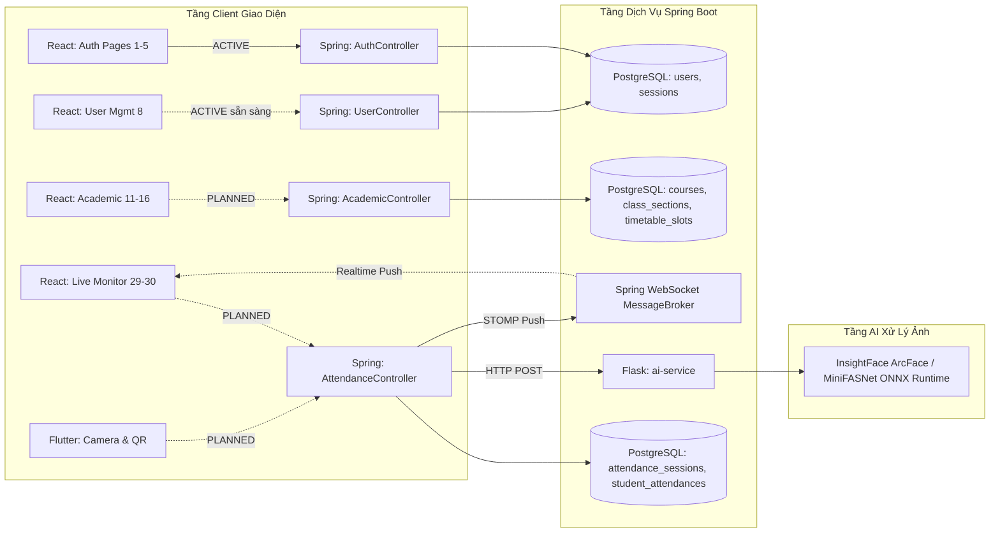

# UniCheck — Bản Đồ Khoảng Cách API & Phụ Thuộc Kỹ Thuật (API Gap & Dependency Map)

> **Mã tài liệu:** AUDIT-API-GAP-MAP-2026  
> **Phiên bản:** 2.0.0 (Chuẩn hóa toàn diện sau PROMPT 00)  
> **Ngày lập:** 15/10/2026  
> **Nguyên tắc thẩm định:**  
> - **`ACTIVE`**: Endpoint đã có Controller trong Spring Boot hoặc Flask, có DTO, Service và đã có bằng chứng Test Passed.  
> - **`PLANNED`**: Endpoint được đề xuất trong tài liệu đặc tả/OpenAPI nhưng CHƯA tồn tại mã nguồn Controller phía server. Tuyệt đối không đánh nhãn `ACTIVE`.

---

## 1. Danh Mục Các Endpoint Thực Tế Đang Hoạt Động (`ACTIVE` — 72 Endpoints)

### 1.1. Phân Hệ Xác Thực & Bảo Mật (Authentication Controller)

| HTTP Method | Endpoint Tuyến Đường | Controller Phụ Trách | DTO Request / Response | Phía Tiêu Thụ Thực Tế | Trạng Thái Kiểm Thử |
| :---: | :--- | :--- | :--- | :---: | :---: |
| `POST` | `/api/v1/auth/login` | [AuthController.java](file:///c:/Users/Admin/Documents/Antigravity/UniCheck/backend/src/main/java/com/unicheck/controller/AuthController.java) | `LoginRequest` / `LoginResponse` | React FE + Flutter Mobile | **`ACTIVE`** (Passed) |
| `POST` | `/api/v1/auth/refresh-token`| [AuthController.java](file:///c:/Users/Admin/Documents/Antigravity/UniCheck/backend/src/main/java/com/unicheck/controller/AuthController.java) | `RefreshTokenRequest` / `TokenRefreshResponse` | React FE + Flutter Mobile | **`ACTIVE`** (Passed) |
| `POST` | `/api/v1/auth/logout` | [AuthController.java](file:///c:/Users/Admin/Documents/Antigravity/UniCheck/backend/src/main/java/com/unicheck/controller/AuthController.java) | Header Bearer Token | React FE + Flutter Mobile | **`ACTIVE`** (Passed) |
| `GET` | `/api/v1/auth/me` | [AuthController.java](file:///c:/Users/Admin/Documents/Antigravity/UniCheck/backend/src/main/java/com/unicheck/controller/AuthController.java) | `UserProfileResponse` | React FE + Flutter Mobile | **`ACTIVE`** (Passed) |
| `PUT` | `/api/v1/auth/profile` | [AuthController.java](file:///c:/Users/Admin/Documents/Antigravity/UniCheck/backend/src/main/java/com/unicheck/controller/AuthController.java) | `UpdateProfileRequest` / `UserProfileResponse` | React FE + Flutter Mobile | **`ACTIVE`** (Passed) |
| `POST` | `/api/v1/auth/change-password` | [AuthController.java](file:///c:/Users/Admin/Documents/Antigravity/UniCheck/backend/src/main/java/com/unicheck/controller/AuthController.java) | `ChangePasswordRequest` | React FE + Flutter Mobile | **`ACTIVE`** (Passed) |
| `POST` | `/api/v1/auth/forgot-password` | [AuthController.java](file:///c:/Users/Admin/Documents/Antigravity/UniCheck/backend/src/main/java/com/unicheck/controller/AuthController.java) | `ForgotPasswordRequest` | React FE + Flutter Mobile | **`ACTIVE`** (Passed) |

*Ghi chú: Toàn bộ 7 endpoints trên đi kèm các Route Alias tương thích ngược (`/auth/login` = `/api/v1/auth/login`, `/auth/refresh` = `/api/v1/auth/refresh-token`) được bảo vệ bằng hợp đồng kiểm thử `RouteAliasCompatibilityContractTest.java`.*

---

### 1.2. Phân Hệ Quản Lý Người Dùng (User Controller)

| HTTP Method | Endpoint Tuyến Đường | Controller Phụ Trách | DTO Request / Response | Phía Tiêu Thụ Thực Tế | Trạng Thái Kiểm Thử |
| :---: | :--- | :--- | :--- | :---: | :---: |
| `GET` | `/api/v1/users` | [UserController.java](file:///c:/Users/Admin/Documents/Antigravity/UniCheck/backend/src/main/java/com/unicheck/controller/UserController.java) | Query params / `PageResponse<UserResponse>` | *Chưa kết nối FE* | **`ACTIVE`** (Passed) |
| `GET` | `/api/v1/users/{id}` | [UserController.java](file:///c:/Users/Admin/Documents/Antigravity/UniCheck/backend/src/main/java/com/unicheck/controller/UserController.java) | Path Variable / `UserResponse` | *Chưa kết nối FE* | **`ACTIVE`** (Passed) |
| `POST` | `/api/v1/users` | [UserController.java](file:///c:/Users/Admin/Documents/Antigravity/UniCheck/backend/src/main/java/com/unicheck/controller/UserController.java) | `CreateUserRequest` / `UserResponse` | *Chưa kết nối FE* | **`ACTIVE`** (Passed) |
| `PUT` | `/api/v1/users/{id}` | [UserController.java](file:///c:/Users/Admin/Documents/Antigravity/UniCheck/backend/src/main/java/com/unicheck/controller/UserController.java) | `UpdateUserRequest` / `UserResponse` | *Chưa kết nối FE* | **`ACTIVE`** (Passed) |
| `PATCH`| `/api/v1/users/{id}/status` | [UserController.java](file:///c:/Users/Admin/Documents/Antigravity/UniCheck/backend/src/main/java/com/unicheck/controller/UserController.java) | `StatusUpdateRequest` / `UserResponse` | *Chưa kết nối FE* | **`ACTIVE`** (Passed) |
| `DELETE`| `/api/v1/users/{id}` | [UserController.java](file:///c:/Users/Admin/Documents/Antigravity/UniCheck/backend/src/main/java/com/unicheck/controller/UserController.java) | Path Variable / Void | *Chưa kết nối FE* | **`ACTIVE`** (Passed) |
| `POST` | `/api/v1/users/import-csv` | [UserController.java](file:///c:/Users/Admin/Documents/Antigravity/UniCheck/backend/src/main/java/com/unicheck/controller/UserController.java) | `MultipartFile` / `CsvImportResultResponse` | *Chưa kết nối FE* | **`ACTIVE`** (Passed) |
| `GET` | `/api/v1/users/check-username` | [UserController.java](file:///c:/Users/Admin/Documents/Antigravity/UniCheck/backend/src/main/java/com/unicheck/controller/UserController.java) | Query param / `Boolean` | *Chưa kết nối FE* | **`ACTIVE`** (Passed) |

---

### 1.3. Phân Hệ AI Microservice (Flask — Động Cơ Nhận Diện Khuôn Mặt Thực Tế TASK-03)

| HTTP Method | Endpoint Tuyến Đường | Tệp Mã Nguồn | Trạng Thái Thực Tế | Ghi Chú |
| :---: | :--- | :--- | :---: | :--- |
| `GET` | `/health` | `ai-service/app.py` | **`ACTIVE`** (Passed) | Kiểm tra trạng thái service và readiness của ArcFace ONNX model & YuNet detector. |
| `POST` | `/api/v1/face/extract-embedding` | `ai-service/app.py` | **`ACTIVE`** (Passed) | Pipeline thực tế: YuNet Detect -> Affine Align (112x112) -> ArcFace MobileFaceNet xuất vector 512-dim chuẩn hóa L2 (14.6ms CPU). |
| `POST` | `/api/v1/face/verify-face` | `ai-service/app.py` | **`ACTIVE`** (Passed) | So khớp danh tính bằng Cosine Similarity & Euclidean Distance, cấu hình động ngưỡng `AI_FACE_MATCH_THRESHOLD` (mặc định 0.68). |
| `POST` | `/api/v1/face/check-liveness` | `ai-service/app.py` | **`FAIL_CLOSED`** (Passed) | Chặn đứng mock bypass: Trả về HTTP 501 `UNAVAILABLE`, `is_live: false`, `fail_closed: true`, mã lỗi `ERR_3003`. Chờ MiniFASNet (TASK-07). |

### 1.4. Phân Hệ Học Vụ: Học Phần & Học Kỳ (TASK-02A)

| HTTP Method | Endpoint Tuyến Đường | Controller Phụ Trách | DTO Request / Response | Phía Tiêu Thụ Thực Tế | Trạng Thái Kiểm Thử |
| :---: | :--- | :--- | :--- | :---: | :---: |
| `GET` | `/api/v1/courses` | `CourseController.java` | Query params / `PageResponse<CourseResponse>` | React FE (`/admin/courses`) | **`ACTIVE`** (Passed) |
| `GET` | `/api/v1/courses/{id}` | `CourseController.java` | Path Variable / `CourseResponse` | React FE | **`ACTIVE`** (Passed) |
| `POST` | `/api/v1/courses` | `CourseController.java` | `CourseCreateRequest` / `CourseResponse` | React FE | **`ACTIVE`** (Passed) |
| `PUT` | `/api/v1/courses/{id}` | `CourseController.java` | `CourseUpdateRequest` / `CourseResponse` | React FE | **`ACTIVE`** (Passed) |
| `DELETE` | `/api/v1/courses/{id}` | `CourseController.java` | Path Variable / Void | React FE | **`ACTIVE`** (Passed) |
| `GET` | `/api/v1/courses/check-code` | `CourseController.java` | Query param / `Boolean` | React FE | **`ACTIVE`** (Passed) |
| `GET` | `/api/v1/courses/summaries` | `CourseController.java` | Void / `List<CourseSummaryDto>` | React FE | **`ACTIVE`** (Passed) |
| `GET` | `/api/v1/semesters` | `SemesterController.java` | Query params / `PageResponse<SemesterResponse>` | React FE (`/admin/semesters`) | **`ACTIVE`** (Passed) |
| `GET` | `/api/v1/semesters/{id}` | `SemesterController.java` | Path Variable / `SemesterResponse` | React FE | **`ACTIVE`** (Passed) |
| `GET` | `/api/v1/semesters/active` | `SemesterController.java` | Void / `SemesterResponse` | React FE | **`ACTIVE`** (Passed) |
| `POST` | `/api/v1/semesters` | `SemesterController.java` | `SemesterCreateRequest` / `SemesterResponse` | React FE | **`ACTIVE`** (Passed) |
| `PUT` | `/api/v1/semesters/{id}` | `SemesterController.java` | `SemesterUpdateRequest` / `SemesterResponse` | React FE | **`ACTIVE`** (Passed) |
| `DELETE` | `/api/v1/semesters/{id}` | `SemesterController.java` | Path Variable / Void | React FE | **`ACTIVE`** (Passed) |
| `GET` | `/api/v1/semesters/check-code` | `SemesterController.java` | Query param / `Boolean` | React FE | **`ACTIVE`** (Passed) |
| `PUT` | `/api/v1/semesters/{id}/close` | `SemesterController.java` | Path Variable / `SemesterResponse` | React FE | **`ACTIVE`** (Passed) |

---

### 1.5. Phân Hệ Lớp Học Phần & Ghi Danh Sinh Viên (TASK-02B)

| HTTP Method | Endpoint Tuyến Đường | Controller Phụ Trách | DTO Request / Response | Phía Tiêu Thụ Thực Tế | Trạng Thái Kiểm Thử |
| :---: | :--- | :--- | :--- | :---: | :---: |
| `GET` | `/api/v1/classes` | [ClassSectionController.java](file:///c:/Users/Admin/Documents/Antigravity/UniCheck/backend/src/main/java/com/unicheck/controller/ClassSectionController.java) | Query params / `PageResponse<ClassSectionResponse>` | React FE (`/admin/classes`) | **`ACTIVE`** (Passed) |
| `GET` | `/api/v1/classes/{className}` | [ClassSectionController.java](file:///c:/Users/Admin/Documents/Antigravity/UniCheck/backend/src/main/java/com/unicheck/controller/ClassSectionController.java) | Path Variable / `ClassSectionResponse` | React FE | **`ACTIVE`** (Passed) |
| `GET` | `/api/v1/classes/summaries` | [ClassSectionController.java](file:///c:/Users/Admin/Documents/Antigravity/UniCheck/backend/src/main/java/com/unicheck/controller/ClassSectionController.java) | Query param `semesterId` / `List<ClassSectionSummaryDto>` | React FE | **`ACTIVE`** (Passed) |
| `GET` | `/api/v1/classes/stats` | [ClassSectionController.java](file:///c:/Users/Admin/Documents/Antigravity/UniCheck/backend/src/main/java/com/unicheck/controller/ClassSectionController.java) | Query param `semesterId` / `ClassSectionStatsResponse` | React FE | **`ACTIVE`** (Passed) |
| `GET` | `/api/v1/classes/check-name` | [ClassSectionController.java](file:///c:/Users/Admin/Documents/Antigravity/UniCheck/backend/src/main/java/com/unicheck/controller/ClassSectionController.java) | Query param `className` / `Boolean` | React FE | **`ACTIVE`** (Passed) |
| `POST` | `/api/v1/classes` | [ClassSectionController.java](file:///c:/Users/Admin/Documents/Antigravity/UniCheck/backend/src/main/java/com/unicheck/controller/ClassSectionController.java) | `ClassSectionCreateRequest` / `ClassSectionResponse` | React FE | **`ACTIVE`** (Passed) |
| `PUT` | `/api/v1/classes/{className}` | [ClassSectionController.java](file:///c:/Users/Admin/Documents/Antigravity/UniCheck/backend/src/main/java/com/unicheck/controller/ClassSectionController.java) | `ClassSectionUpdateRequest` / `ClassSectionResponse` | React FE | **`ACTIVE`** (Passed) |
| `DELETE` | `/api/v1/classes/{className}` | [ClassSectionController.java](file:///c:/Users/Admin/Documents/Antigravity/UniCheck/backend/src/main/java/com/unicheck/controller/ClassSectionController.java) | Path Variable / Void | React FE | **`ACTIVE`** (Passed) |
| `GET` | `/api/v1/classes/{className}/students` | [ClassSectionController.java](file:///c:/Users/Admin/Documents/Antigravity/UniCheck/backend/src/main/java/com/unicheck/controller/ClassSectionController.java) | Path Variable / `List<EnrollmentResponse>` | React FE (`/admin/enrollments`) | **`ACTIVE`** (Passed) |
| `POST` | `/api/v1/classes/{className}/students` | [ClassSectionController.java](file:///c:/Users/Admin/Documents/Antigravity/UniCheck/backend/src/main/java/com/unicheck/controller/ClassSectionController.java) | `studentId` / `EnrollmentResponse` | React FE | **`ACTIVE`** (Passed) |
| `GET` | `/api/v1/enrollments` | [EnrollmentController.java](file:///c:/Users/Admin/Documents/Antigravity/UniCheck/backend/src/main/java/com/unicheck/controller/EnrollmentController.java) | Query params / `PageResponse<EnrollmentResponse>` | React FE | **`ACTIVE`** (Passed) |
| `GET` | `/api/v1/enrollments/{id}` | [EnrollmentController.java](file:///c:/Users/Admin/Documents/Antigravity/UniCheck/backend/src/main/java/com/unicheck/controller/EnrollmentController.java) | Path Variable / `EnrollmentResponse` | React FE | **`ACTIVE`** (Passed) |
| `POST` | `/api/v1/enrollments` | [EnrollmentController.java](file:///c:/Users/Admin/Documents/Antigravity/UniCheck/backend/src/main/java/com/unicheck/controller/EnrollmentController.java) | `EnrollmentCreateRequest` / `EnrollmentResponse` | React FE | **`ACTIVE`** (Passed) |
| `DELETE` | `/api/v1/enrollments/{id}` | [EnrollmentController.java](file:///c:/Users/Admin/Documents/Antigravity/UniCheck/backend/src/main/java/com/unicheck/controller/EnrollmentController.java) | Path Variable / Void | React FE | **`ACTIVE`** (Passed) |

*Ghi chú: Toàn bộ endpoints trên hỗ trợ cả dual route `/api/classes` & `/api/v1/classes`, `/api/enrollments` & `/api/v1/enrollments` tương thích ngược.*
 
---

### 1.6. Phân Hệ Quản Lý Cơ Sở Vật Chất & Wi-Fi Access Points (TASK-02C - F-13)

| HTTP Method | Endpoint Tuyến Đường | Controller Phụ Trách | DTO Request / Response | Phía Tiêu Thụ Thực Tế | Trạng Thái Kiểm Thử |
| :---: | :--- | :--- | :--- | :---: | :---: |
| `GET` | `/api/v1/facilities/rooms` | [FacilityController.java](file:///c:/Users/Admin/Documents/Antigravity/UniCheck/backend/src/main/java/com/unicheck/controller/FacilityController.java) | Query params / `PageResponse<RoomResponse>` | React FE (`/admin/facilities`) | **`ACTIVE`** (Passed) |
| `GET` | `/api/v1/facilities/rooms/{id}` | [FacilityController.java](file:///c:/Users/Admin/Documents/Antigravity/UniCheck/backend/src/main/java/com/unicheck/controller/FacilityController.java) | Path Variable / `RoomDetailResponse` | React FE | **`ACTIVE`** (Passed) |
| `POST` | `/api/v1/facilities/rooms` | [FacilityController.java](file:///c:/Users/Admin/Documents/Antigravity/UniCheck/backend/src/main/java/com/unicheck/controller/FacilityController.java) | `RoomCreateRequest` / `RoomResponse` | React FE | **`ACTIVE`** (Passed) |
| `PUT` | `/api/v1/facilities/rooms/{id}` | [FacilityController.java](file:///c:/Users/Admin/Documents/Antigravity/UniCheck/backend/src/main/java/com/unicheck/controller/FacilityController.java) | `RoomUpdateRequest` / `RoomResponse` | React FE | **`ACTIVE`** (Passed) |
| `DELETE` | `/api/v1/facilities/rooms/{id}` | [FacilityController.java](file:///c:/Users/Admin/Documents/Antigravity/UniCheck/backend/src/main/java/com/unicheck/controller/FacilityController.java) | Path Variable / Void (Chặn nếu có lịch) | React FE | **`ACTIVE`** (Passed) |
| `GET` | `/api/v1/facilities/rooms/check-code` | [FacilityController.java](file:///c:/Users/Admin/Documents/Antigravity/UniCheck/backend/src/main/java/com/unicheck/controller/FacilityController.java) | Query param `code` / `Boolean` | React FE | **`ACTIVE`** (Passed) |
| `GET` | `/api/v1/facilities/rooms/buildings` | [FacilityController.java](file:///c:/Users/Admin/Documents/Antigravity/UniCheck/backend/src/main/java/com/unicheck/controller/FacilityController.java) | Void / `List<String>` | React FE | **`ACTIVE`** (Passed) |
| `GET` | `/api/v1/facilities/rooms/stats` | [FacilityController.java](file:///c:/Users/Admin/Documents/Antigravity/UniCheck/backend/src/main/java/com/unicheck/controller/FacilityController.java) | Void / `FacilityStatsResponse` | React FE | **`ACTIVE`** (Passed) |
| `GET` | `/api/v1/facilities/wifi-ap` | [FacilityController.java](file:///c:/Users/Admin/Documents/Antigravity/UniCheck/backend/src/main/java/com/unicheck/controller/FacilityController.java) | Query params / `PageResponse<WifiAccessPointResponse>` | React FE | **`ACTIVE`** (Passed) |
| `GET` | `/api/v1/facilities/wifi-ap/{id}` | [FacilityController.java](file:///c:/Users/Admin/Documents/Antigravity/UniCheck/backend/src/main/java/com/unicheck/controller/FacilityController.java) | Path Variable / `WifiAccessPointResponse` | React FE | **`ACTIVE`** (Passed) |
| `POST` | `/api/v1/facilities/wifi-ap` | [FacilityController.java](file:///c:/Users/Admin/Documents/Antigravity/UniCheck/backend/src/main/java/com/unicheck/controller/FacilityController.java) | `WifiAccessPointCreateRequest` / `WifiAccessPointResponse` | React FE | **`ACTIVE`** (Passed) |
| `PUT` | `/api/v1/facilities/wifi-ap/{id}` | [FacilityController.java](file:///c:/Users/Admin/Documents/Antigravity/UniCheck/backend/src/main/java/com/unicheck/controller/FacilityController.java) | `WifiAccessPointUpdateRequest` / `WifiAccessPointResponse` | React FE | **`ACTIVE`** (Passed) |
| `DELETE` | `/api/v1/facilities/wifi-ap/{id}` | [FacilityController.java](file:///c:/Users/Admin/Documents/Antigravity/UniCheck/backend/src/main/java/com/unicheck/controller/FacilityController.java) | Path Variable / Void (Chặn nếu gán phòng) | React FE | **`ACTIVE`** (Passed) |
| `GET` | `/api/v1/facilities/wifi-ap/check-bssid` | [FacilityController.java](file:///c:/Users/Admin/Documents/Antigravity/UniCheck/backend/src/main/java/com/unicheck/controller/FacilityController.java) | Query param `bssid` / `Boolean` | React FE | **`ACTIVE`** (Passed) |
| `GET` | `/api/v1/facilities/rooms/{id}/wifi-ap` | [FacilityController.java](file:///c:/Users/Admin/Documents/Antigravity/UniCheck/backend/src/main/java/com/unicheck/controller/FacilityController.java) | Path Variable / `List<RoomWifiAccessPointResponse>` | React FE | **`ACTIVE`** (Passed) |
| `POST` | `/api/v1/facilities/rooms/{id}/wifi-ap` | [FacilityController.java](file:///c:/Users/Admin/Documents/Antigravity/UniCheck/backend/src/main/java/com/unicheck/controller/FacilityController.java) | `AssignWifiApRequest` / `RoomWifiAccessPointResponse` | React FE | **`ACTIVE`** (Passed) |
| `DELETE`| `/api/v1/facilities/rooms/{id}/wifi-ap/{apId}` | [FacilityController.java](file:///c:/Users/Admin/Documents/Antigravity/UniCheck/backend/src/main/java/com/unicheck/controller/FacilityController.java) | Path Variables / Void | React FE | **`ACTIVE`** (Passed) |

*Ghi chú: Toàn bộ endpoints trên hỗ trợ cả dual route `/api/facilities` & `/api/v1/facilities` tương thích ngược.*

---

### 1.7. Phân Hệ Thời Khóa Biểu & Xếp Lịch Học (TASK-02D - F-16)

| HTTP Method | Endpoint Tuyến Đường | Controller Phụ Trách | DTO Request / Response | Phía Tiêu Thụ Thực Tế | Trạng Thái Kiểm Thử |
| :---: | :--- | :--- | :--- | :---: | :---: |
| `GET` | `/api/v1/timetable/slots` | [TimetableController.java](file:///c:/Users/Admin/Documents/Antigravity/UniCheck/backend/src/main/java/com/unicheck/controller/TimetableController.java) | Query params / `PageResponse<TimetableSlotResponse>` | React FE (`/admin/timetable`) | **`ACTIVE`** (Passed) |
| `GET` | `/api/v1/timetable/slots/{id}` | [TimetableController.java](file:///c:/Users/Admin/Documents/Antigravity/UniCheck/backend/src/main/java/com/unicheck/controller/TimetableController.java) | Path Variable / `TimetableSlotResponse` | React FE | **`ACTIVE`** (Passed) |
| `POST` | `/api/v1/timetable/slots` | [TimetableController.java](file:///c:/Users/Admin/Documents/Antigravity/UniCheck/backend/src/main/java/com/unicheck/controller/TimetableController.java) | `TimetableSlotCreateRequest` / `TimetableSlotResponse` | React FE | **`ACTIVE`** (Passed) |
| `PUT` | `/api/v1/timetable/slots/{id}` | [TimetableController.java](file:///c:/Users/Admin/Documents/Antigravity/UniCheck/backend/src/main/java/com/unicheck/controller/TimetableController.java) | `TimetableSlotUpdateRequest` / `TimetableSlotResponse` | React FE | **`ACTIVE`** (Passed) |
| `DELETE` | `/api/v1/timetable/slots/{id}` | [TimetableController.java](file:///c:/Users/Admin/Documents/Antigravity/UniCheck/backend/src/main/java/com/unicheck/controller/TimetableController.java) | Path Variable / Void (Chặn nếu có điểm danh) | React FE | **`ACTIVE`** (Passed) |
| `GET` | `/api/v1/timetable/me` | [TimetableController.java](file:///c:/Users/Admin/Documents/Antigravity/UniCheck/backend/src/main/java/com/unicheck/controller/TimetableController.java) | Query params `startDate`, `endDate` / `List<TimetableSlotResponse>` | Giảng viên & Sinh viên | **`ACTIVE`** (Passed) |
| `GET` | `/api/v1/timetable/slot-types` | [TimetableController.java](file:///c:/Users/Admin/Documents/Antigravity/UniCheck/backend/src/main/java/com/unicheck/controller/TimetableController.java) | Void / `List<SlotTypeResponse>` | React FE | **`ACTIVE`** (Passed) |
| `POST` | `/api/v1/timetable/slots/check-conflict` | [TimetableController.java](file:///c:/Users/Admin/Documents/Antigravity/UniCheck/backend/src/main/java/com/unicheck/controller/TimetableController.java) | `TimetableConflictCheckRequest` / `TimetableConflictCheckResponse` | React FE (Realtime check) | **`ACTIVE`** (Passed) |
| `GET` | `/api/v1/timetable/stats` | [TimetableController.java](file:///c:/Users/Admin/Documents/Antigravity/UniCheck/backend/src/main/java/com/unicheck/controller/TimetableController.java) | Query param `semesterId` / `TimetableStatsResponse` | React FE (KPI Bento) | **`ACTIVE`** (Passed) |
| `PUT` | `/api/v1/timetable/slots/{id}/cancel` | [TimetableController.java](file:///c:/Users/Admin/Documents/Antigravity/UniCheck/backend/src/main/java/com/unicheck/controller/TimetableController.java) | Path Variable / `TimetableSlotResponse` | React FE | **`ACTIVE`** (Passed) |
| `PUT` | `/api/v1/timetable/slots/{id}/reschedule` | [TimetableController.java](file:///c:/Users/Admin/Documents/Antigravity/UniCheck/backend/src/main/java/com/unicheck/controller/TimetableController.java) | `TimetableSlotUpdateRequest` / `TimetableSlotResponse` | React FE | **`ACTIVE`** (Passed) |

*Ghi chú: Toàn bộ endpoints trên hỗ trợ cả dual route `/api/timetable` & `/api/v1/timetable` tương thích ngược.*

### 1.8. Phân Hệ Đăng Ký Sinh Trắc Học Face-ID (TASK-04 - F-17)

| HTTP Method | Endpoint Tuyến Đường | Controller Phụ Trách | DTO Request / Response | Phía Tiêu Thụ Thực Tế | Trạng Thái Kiểm Thử |
| :---: | :--- | :--- | :--- | :---: | :---: |
| `POST` | `/api/v1/attendance/register-face` | [FaceEnrollmentController.java](file:///c:/Users/Admin/Documents/Antigravity/UniCheck/backend/src/main/java/com/unicheck/controller/FaceEnrollmentController.java) | `FaceRegistrationRequest` / `FaceEnrollmentResponse` | React FE (`/student/face-enrollment`) + Flutter Mobile | **`ACTIVE`** (Passed) |
| `GET` | `/api/v1/attendance/face-status` | [FaceEnrollmentController.java](file:///c:/Users/Admin/Documents/Antigravity/UniCheck/backend/src/main/java/com/unicheck/controller/FaceEnrollmentController.java) | Void / `FaceStatusResponse` | React FE + Flutter Mobile | **`ACTIVE`** (Passed) |
| `DELETE` | `/api/v1/attendance/face-data` | [FaceEnrollmentController.java](file:///c:/Users/Admin/Documents/Antigravity/UniCheck/backend/src/main/java/com/unicheck/controller/FaceEnrollmentController.java) | Void / Void | React FE + Flutter Mobile | **`ACTIVE`** (Passed) |
| `GET` | `/api/v1/attendance/face-status/user/{userId}` | [FaceEnrollmentController.java](file:///c:/Users/Admin/Documents/Antigravity/UniCheck/backend/src/main/java/com/unicheck/controller/FaceEnrollmentController.java) | Path Variable / `FaceStatusResponse` | Admin Web | **`ACTIVE`** (Passed) |

*Ghi chú: Endpoint hỗ trợ cả alias `/api/attendance/register-face`, `/api/v1/face/enroll` và `/api/v1/face/status` tương thích ngược.*

---

### 1.9. Phân Hệ Quản Lý Phiên Điểm Danh & Cấu Hình Cơ Chế (TASK-05 - F-21 & F-31)

| HTTP Method | Endpoint Tuyến Đường | Controller Phụ Trách | DTO Request / Response | Phía Tiêu Thụ Thực Tế | Trạng Thái Kiểm Thử |
| :---: | :--- | :--- | :--- | :---: | :---: |
| `GET` | `/api/v1/attendance/sessions` | [AttendanceSessionController.java](file:///c:/Users/Admin/Documents/Antigravity/UniCheck/backend/src/main/java/com/unicheck/controller/AttendanceSessionController.java) | Query params / `PageResponse<AttendanceSessionResponse>` | React FE (`/admin/attendance/sessions`) | **`ACTIVE`** (Passed) |
| `GET` | `/api/v1/attendance/sessions/{id}` | [AttendanceSessionController.java](file:///c:/Users/Admin/Documents/Antigravity/UniCheck/backend/src/main/java/com/unicheck/controller/AttendanceSessionController.java) | Path Variable / `AttendanceSessionResponse` | React FE | **`ACTIVE`** (Passed) |
| `POST` | `/api/v1/attendance/sessions` | [AttendanceSessionController.java](file:///c:/Users/Admin/Documents/Antigravity/UniCheck/backend/src/main/java/com/unicheck/controller/AttendanceSessionController.java) | `AttendanceSessionCreateRequest` / `AttendanceSessionResponse` | React FE | **`ACTIVE`** (Passed) |
| `POST` | `/api/v1/attendance/sessions/{id}/open` | [AttendanceSessionController.java](file:///c:/Users/Admin/Documents/Antigravity/UniCheck/backend/src/main/java/com/unicheck/controller/AttendanceSessionController.java) | Path Variable / `AttendanceSessionResponse` | React FE | **`ACTIVE`** (Passed) |
| `POST` | `/api/v1/attendance/sessions/{id}/close` | [AttendanceSessionController.java](file:///c:/Users/Admin/Documents/Antigravity/UniCheck/backend/src/main/java/com/unicheck/controller/AttendanceSessionController.java) | Path Variable / `AttendanceSessionResponse` | React FE | **`ACTIVE`** (Passed) |
| `GET` | `/api/v1/attendance/sessions/{id}/status` | [AttendanceSessionController.java](file:///c:/Users/Admin/Documents/Antigravity/UniCheck/backend/src/main/java/com/unicheck/controller/AttendanceSessionController.java) | Path Variable / `AttendanceSessionStatusResponse` | React FE (Contract cho TASK-06) | **`ACTIVE`** (Passed) |
| `GET` | `/api/v1/attendance/sessions/stats` | [AttendanceSessionController.java](file:///c:/Users/Admin/Documents/Antigravity/UniCheck/backend/src/main/java/com/unicheck/controller/AttendanceSessionController.java) | Void / `AttendanceSessionStatsResponse` | React FE (4 KPI Cards) | **`ACTIVE`** (Passed) |
| `GET` | `/api/v1/attendance/configs` | [AttendanceSessionController.java](file:///c:/Users/Admin/Documents/Antigravity/UniCheck/backend/src/main/java/com/unicheck/controller/AttendanceSessionController.java) | Void / `AttendanceConfigDto` | React FE (`/admin/attendance/configs`) | **`ACTIVE`** (Passed) |
| `PUT` | `/api/v1/attendance/configs` | [AttendanceSessionController.java](file:///c:/Users/Admin/Documents/Antigravity/UniCheck/backend/src/main/java/com/unicheck/controller/AttendanceSessionController.java) | `AttendanceConfigDto` / `AttendanceConfigDto` | React FE (ADMIN only) | **`ACTIVE`** (Passed) |
| `GET` | `/api/v1/attendance/sessions/{id}/attendances` | [AttendanceSessionController.java](file:///c:/Users/Admin/Documents/Antigravity/UniCheck/backend/src/main/java/com/unicheck/controller/AttendanceSessionController.java) | Path Variable / `List<StudentAttendanceResponse>` | React FE (Live Check-in Drawer) | **`ACTIVE`** (Passed) |

*Ghi chú: Toàn bộ endpoints trên hỗ trợ cả dual route `/api/attendance` & `/api/v1/attendance` tương thích ngược.*

---

## 2. Danh Mục Các Endpoint Cần Triển Khai (`PLANNED` — Chưa Có Controller)

Dưới đây là các API bắt buộc phải xây dựng trong các giai đoạn tiếp theo để phục vụ các màn hình Stitch và luồng điểm danh còn lại:

### 2.1. Phân Hệ Sinh Mã QR Động & Check-in (`PLANNED` - TASK-06 & TASK-07)
- `GET /api/v1/attendance/sessions/{id}/qr-token`: Lấy mã QR TOTP xoay vòng mỗi 5-10 giây (Stitch `5c0df9af4d2545919e8f774c1159e7da`).
- `POST /api/v1/attendance/check-in`: Sinh viên check-in 4 lớp (BSSID + QR Token + Liveness + Face Match).
- `GET /api/v1/attendance/sessions/{id}/live`: Danh sách sinh viên đã điểm danh realtime qua WebSocket (Stitch `c20e515d6d0940379d90ea268522b07e`).
- `WS /topic/session.{id}`: Kênh WebSocket STOMP phát sóng sự kiện điểm danh tức thì.

### 2.2. Phân Hệ Đơn Từ, Báo Cáo & Sổ Điểm (`PLANNED`)
- `GET /api/v1/requests` & `POST /api/v1/requests`: Quản lý đơn xin nghỉ phép, khiếu nại (Stitch `f3fad431243448f4a7758c9ced16b695`, `c7ac82956cfe41b3b762e7aaabc2bcfa`).
- `GET /api/v1/grades` & `PUT /api/v1/grades`: Sổ điểm và đánh giá học phần (Stitch `ef5d3e2ef1f14d349f4f732efcee4e55`).
- `GET /api/v1/reports/attendance`: Thống kê tỷ lệ chuyên cần (Stitch `c9523d6727af4088a7135067d379c570`, `dbeb7a8d359c4fbaa1363673ceac548e`).
- `GET /api/v1/reports/attendance/export-excel`: Xuất file Excel báo cáo điểm danh chuẩn mẫu Bộ GD&ĐT.

---

## 3. Biểu Đồ Phụ Thuộc Gọi API Giữa Các Tầng Hệ Thống

