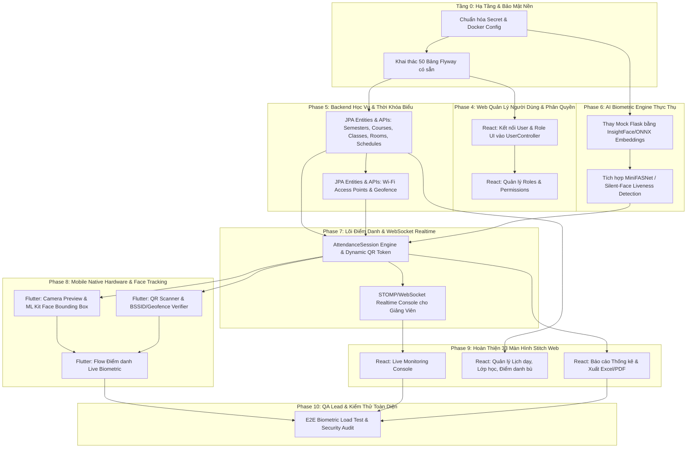

# UniCheck — Kế Hoạch Triển Khai Tiếp Theo (Next Implementation Plan)

> **Tài liệu Kỹ thuật — UniCheck Audit Series**  
> **Phiên bản:** 1.0.0 | **Ngày lập:** 15/10/2026  
> **Trạng thái:** Sẵn sàng thực thi (Ready for Execution)  
> **Nguyên tắc cốt lõi:** Kế thừa 100% các thành phần đã `DONE` (Auth Web, Auth BE, DB Flyway, Flutter Mobile Auth), triển khai tuần tự theo đồ thị phụ thuộc kỹ thuật (Dependency Graph), tuyệt đối không đập đi làm lại.

---

## 1. Bản Đồ Phụ Thuộc Kỹ Thuật (Dependency Graph)

Biểu đồ dưới đây xác định thứ tự thực thi bắt buộc của các module để đảm bảo không bị nghẽn (unblock) các tầng ứng dụng tiếp theo:

---

## 2. Chi Tiết Kế Hoạch Từng Giai Đoạn

---

### Giai Đoạn 4: Web Quản Lý Người Dùng & Hoàn Thiện Tầng Admin (Tuần 1)
**Mục tiêu:** Tận dụng 100% `UserController.java` (đã có sẵn 8 endpoint BE) để kết nối giao diện Web React từ Stitch designs.

#### Các công việc cụ thể:
1. **Frontend — User Management Module (`frontend/src/features/users/`):**
   - **Tích hợp Stitch Screen `21275607791c43e58ee6a5b2db656d20` (User List):**
     - Đọc dữ liệu từ `GET /api/v1/users` (kèm pagination, filter theo role, department, status, search keyword).
     - Component bảng dữ liệu: Avatar, mã số (MSSV/CBGV), Họ tên, Email, Vai trò, Trạng thái hoạt động, Nút thao tác (View, Edit, Lock, Reset Password).
   - **Tích hợp Stitch Screen `8e1010eda64348f98bd95f7c01648bef` (Quản lý sinh viên):**
     - Hiển thị danh sách và chi tiết thông tin sinh viên từ `GET /api/v1/users?role=STUDENT`.
     - Cho phép chỉnh sửa thông tin qua `PUT /api/v1/users/{id}`.
     - Khóa/mở khóa tài khoản qua `PATCH /api/v1/users/{id}/status`.
   - **Tích hợp Stitch Screen `3c68af65d6ae4a0f9509aed6e9ea81be` (Quản lý giảng viên):**
     - Danh sách và hồ sơ giảng viên qua `GET /api/v1/users?role=LECTURER`.
     - Form thêm mới người dùng đơn lẻ qua `POST /api/v1/users` và upload file Excel/CSV danh sách qua `POST /api/v1/users/import-csv`.
2. **Frontend — Quyền hạn & Phân vai trò:**
   - Sử dụng hệ thống phân quyền sẵn có (`UserPermission`, `Role` ADMIN/LECTURER/STUDENT).
3. **Backend — Bổ sung & Kiểm thử:**
   - `UserController.java` đã có sẵn 8 APIs và test `UserManagementIntegrationTest` hoàn chỉnh.

---

### Giai Đoạn 5: Backend Học Vụ, Thời Khóa Biểu & Hạ Tầng Phòng Học (Tuần 2)
**Mục tiêu:** Hiện thực hóa các bảng dữ liệu học vụ trong Flyway migrations V1/V3 thành JPA Entities, Spring Data Repositories và REST APIs.

#### Các công việc cụ thể:
1. **JPA Entity & Repository Generation:**
   - Tạo các Entity tương ứng với các bảng thực tế trong Flyway:
     - `Semester` (`semesters`), `SemesterConfig` (`semester_configs`), `Holiday` (`holidays`).
     - `Course` (`courses`), `CoursePrerequisite` (`course_prerequisites`).
     - `ClassSection` (`class_sections` — PK: `class_name`), `Enrollment` (`enrollments`).
     - `Room` (`rooms`), `WifiAccessPoint` (`wifi_access_points`), `RoomWifiAccessPoint` (`room_wifi_access_points`), `TimetableSlot` (`timetable_slots`).
2. **Business Services & REST Controllers:**
   - `AcademicController`: Quản lý năm học, học kỳ, khoa, bộ môn.
   - `ClassSectionController`: Quản lý môn học, lớp học phần, gán giảng viên giảng dạy, danh sách sinh viên theo lớp.
   - `ScheduleController`: Lập lịch học, thời khóa biểu hàng tuần, phòng học, ca học (`timetable_slots`).
   - `FacilityController`: Quản lý phòng học và danh sách Wi-Fi BSSID/SSID (`room_wifi_access_points`).
3. **Frontend Integration:**
   - Tích hợp Stitch Screen `495a21f075ca479698f5f5075cee8a41` (Quản lý lớp học phần).
   - Tích hợp Stitch Screen `a9f520acd00440c8a26633aec9a8799c` (Danh mục học phần).
   - Tích hợp Stitch Screen `ac1b85bea7f6478e9c77fd6a4e9594f9` (Thời khóa biểu).
   - Tích hợp Stitch Screen `e796d9e992364bfcbf8a32a6330927ce` (Phòng học & Wi-Fi AP).

---

### Giai Đoạn 6: AI Biometric Engine Thực Thụ (Tuần 3)
**Mục tiêu:** Thay thế hoàn toàn mã mock trong `ai-service/app.py` bằng pipeline AI trích xuất vector khuôn mặt và kiểm tra gian lận (Liveness/Anti-Spoofing).

#### Các công việc cụ thể:
1. **Nâng cấp Thư viện & Mô hình (`ai-service/requirements.txt`):**
   - Thêm `insightface==0.7.3`, `onnxruntime==1.19.0`, `opencv-python-headless==4.10.0.84`, `numpy==1.26.4`.
   - Download model weights tiền huấn luyện nhẹ và nhanh:
     - Detection: `SCRFD_500M_KPS` hoặc `RetinaFace-MobileNet`.
     - Recognition / Embeddings: `ArcFace / MobileFaceNet` (vector kích thước 512-dim).
     - Liveness / Anti-spoofing: `MiniFASNetV2` (phát hiện màn hình điện thoại, ảnh in giấy, mặt nạ).
2. **Triển khai Pipeline Xử lý:**
   - **Endpoint `POST /extract-embedding`:**
     - Đầu vào: Base64 image hoặc multipart file.
     - Phát hiện khuôn mặt -> Căn chỉnh mắt/mũi (Alignment) -> Kiểm tra độ nét/kích thước -> Trích xuất 512-dim vector dạng L2-normalized.
     - Xử lý các ngoại lệ: `NO_FACE_DETECTED`, `MULTIPLE_FACES_DETECTED`, `FACE_BLURRY`, `FACE_TOO_SMALL`.
   - **Endpoint `POST /check-liveness`:**
     - Phân tích texture, moiré pattern, phản xạ ánh sáng -> Trả về `liveness_score` (0.0 - 1.0) và flag `is_real`.
   - **Endpoint `POST /verify-face`:**
     - So sánh Cosine Similarity giữa ảnh selfie và ảnh mẫu trong cơ sở dữ liệu (`threshold = 0.68`).
3. **Cập nhật Backend Face Service:**
   - Nâng cấp `FaceRecognitionService.java` và `FaceEncoding.java` trong Spring Boot để lưu trữ vector 512-dim.

---

### Giai Đoạn 7: Lõi Điểm Danh Biometric & Realtime WebSocket (Tuần 4)
**Mục tiêu:** Xây dựng quy trình điểm danh bảo mật đa lớp (Multi-factor Attendance Verification) và đẩy dữ liệu realtime về Web giảng viên.

#### Các công việc cụ thể:
1. **Cơ chế Phiên Điểm danh (`AttendanceSession`):**
   - Giảng viên mở phiên điểm danh trên Web hoặc Mobile.
   - Server sinh mã động `Dynamic QR Token` thay đổi mỗi 5–10 giây (TOTP HMAC-SHA256) để chống chụp ảnh QR chia sẻ từ xa.
2. **Quy trình Xác thực 4 Lớp khi Check-in (`AttendanceService.java`):**
   - *Lớp 1 (Network):* BSSID Wi-Fi hoặc Geofence GPS của thiết bị phải khớp với cấu hình của phòng học.
   - *Lớp 2 (Time & QR):* QR token hợp lệ trong khung thời gian cho phép.
   - *Lớp 3 (AI Anti-Spoofing):* Liveness score $\ge 0.85$.
   - *Lớp 4 (AI Face Match):* Cosine Similarity đạt ngưỡng cấu hình động qua bảng `attendance_configs` / biến môi trường `AI_FACE_MATCH_THRESHOLD` (hiệu chỉnh trên tập dữ liệu thực tế).
3. **Realtime Event Dispatching:**
   - Sử dụng Spring WebSocket (`@EnableWebSocketMessageBroker` + STOMP).
   - Topic: `/topic/session.{sessionId}`.
   - Khi sinh viên check-in thành công hoặc bị cảnh báo gian lận, server tự động broadcast payload đến dashboard giảng viên.
4. **Fraud Detection & Audit Logging:**
   - Ghi nhận `SUSPICIOUS_GPS`, `SPOOFED_FACE`, `DUPLICATE_DEVICE`, `IP_MISMATCH` vào bảng `attendance_fraud_logs` và `system_logs`.

---

### Giai Đoạn 8: Flutter Mobile Native Device Hardware Integration (Tuần 5)
**Mục tiêu:** Biến UI Mockup trên Flutter thành ứng dụng Native thực sự kết nối với Camera, ML Kit và Cảm biến mạng.

#### Các công việc cụ thể:
1. **Bổ sung Dependencies (`mobile/pubspec.yaml`):**
   - `camera: ^0.11.0` (Camera preview tốc độ cao).
   - `google_mlkit_face_detection: ^0.12.0` (Face mesh & Bounding box tracking on-device).
   - `mobile_scanner: ^5.2.0` (Quét QR code siêu tốc).
   - `network_info_plus: ^5.0.1` (Đọc BSSID/SSID Wi-Fi phòng học).
   - `geolocator: ^12.0.0` (Đọc tọa độ GPS chính xác).
2. **Màn hình Điểm danh Khuôn mặt (`mobile/lib/feature/attendance/`):**
   - Khởi tạo Camera Controller phía trước (Front camera).
   - Vẽ khung viền (Oval Bounding Box) hướng dẫn sinh viên đặt khuôn mặt đúng vị trí.
   - Thực hiện On-device Face Tracking: Yêu cầu chớp mắt hoặc quay nhẹ góc mặt để kích hoạt chụp ảnh tự động.
   - Gửi ảnh cùng QR token, BSSID và Device ID lên Backend API `/api/v1/attendance/check-in`.
3. **Màn hình Đăng ký Khuôn mặt (`Face Registration`):**
   - Chụp 3 góc mặt (chính diện, nghiêng trái, nghiêng phải) gửi lên Backend để khởi tạo Vector Embeddings ban đầu.

---

### Giai Đoạn 9: Hoàn Thiện 33 Màn Hình Stitch Web & Báo Cáo Thống Kê (Tuần 6)
**Mục tiêu:** Dựng toàn bộ 33 màn hình giao diện Web còn lại từ Stitch Project `3214444012266330806`.

#### Các công việc cụ thể:
1. **Live Monitoring Console (`Stitch c20e515d6d0940379d90ea268522b07e`):**
   - Màn hình dành cho Giảng viên trên bục giảng: Hiển thị mã QR động lớn trên máy chiếu.
   - Bảng danh sách sinh viên cập nhật thẻ xanh (Có mặt) tức thì qua WebSocket.
   - Bật chuông cảnh báo đỏ khi phát hiện gian lận (`dd2b950932464528a607e4ebd490f5e1`).
2. **Quản lý Nghỉ phép & Đơn từ học vụ:**
   - Stitch `f3fad431243448f4a7758c9ced16b695` (Giảng viên - Xét duyệt đơn) & `c7ac82956cfe41b3b762e7aaabc2bcfa` (Sinh viên - Gửi đơn).
3. **Báo Cáo & Thống Kê Điểm Danh:**
   - Stitch `c9523d6727af4088a7135067d379c570` (Báo cáo & Thống kê chuyên cần).
   - Tích hợp thư viện Apache POI ở Backend để xuất dữ liệu ra file `.xlsx` chuẩn mẫu Bộ GD&ĐT.
4. **Cài Đặt Cấu Hình Động (`Dynamic Configuration`):**
   - Stitch `300c3071598340e5981a9a5f5097f909` (Cấu hình cơ chế điểm danh): Cấu hình ngưỡng AI Matching, thời gian xoay vòng QR, bán kính Geofence, số lần được phép đi trễ.

---

### Giai Đoạn 10: QA Lead, Security Audit & Tối Ưu Hệ Thống (Tuần 7)
**Mục tiêu:** Đảm bảo hệ thống đạt chuẩn chất lượng doanh nghiệp, chịu tải tốt trong giờ cao điểm điểm danh đầu ca học.

#### Các công việc cụ thể:
1. **Kiểm thử Tự động E2E:**
   - Viết Playwright/Cypress cho các luồng Web Admin và Giảng viên.
   - Viết Flutter Integration Tests cho luồng Check-in Native.
2. **Kiểm thử Tải & Hiệu năng (Load Testing):**
   - Dùng Locust mô phỏng 500 sinh viên check-in đồng thời trong vòng 60 giây.
   - Đo lường độ trễ: AI Response Time $\le 400ms$, WebSocket latency $\le 100ms$, Database query $\le 50ms$.
3. **Bảo mật & Tối ưu Container:**
   - Chuyển toàn bộ Secrets trong `docker-compose.yml` sang biến môi trường `.env` an toàn.
   - Thiết lập Redis Cluster và Postgres Connection Pooling (HikariCP).
   - Kiểm tra OWASP Top 10 và hoàn thiện báo cáo nghiệm thu hệ thống.

---

## 3. Ma Trận Phân Bổ Nhân Sự & Trách Nhiệm (RACI Matrix)

| Giai Đoạn | Senior Full-Stack Architect | AI Engineer | Frontend Engineer | Mobile Engineer | QA Lead |
| :--- | :---: | :---: | :---: | :---: | :---: |
| **P4: User Management Web** | **A** (Review API & DTO) | I | **R** (Dựng 3 màn hình Stitch) | I | **C** (Test CRUD & Import) |
| **P5: Academic & Timetable BE** | **A** (Thiết kế Schema & APIs) | I | **C** (Review hợp đồng API) | **C** (Review Sync Model) | **R** (Viết Integration Tests) |
| **P6: Real AI Engine** | **C** (Chuẩn hóa REST Contract) | **A / R** (Build ONNX/ArcFace) | I | I | **C** (Benchmark False Match) |
| **P7: Attendance Core & WS** | **A** (Thiết kế Multi-factor Flow) | **C** (Latency Tuning) | **C** (STOMP Client) | **C** (Payload Contract) | **R** (Stress Test Concurrent) |
| **P8: Flutter Hardware** | **C** (Device Security Policy) | **C** (Bbox Guidance Tuning) | I | **A / R** (Camera, ML Kit, QR) | **R** (Test trên máy thật iOS/Android) |
| **P9: 33 Stitch Web Screens** | **A** (Design Consistency) | I | **A / R** (Implement Web Views) | I | **C** (Cross-browser Validation) |
| **P10: QA Lead & Release** | **A** (Sign-off Kiến trúc) | **C** (Model Performance Report) | **C** (Fix UI Bugs) | **C** (Fix Mobile Bugs) | **A / R** (Báo cáo Nghiệm thu) |

*Ghi chú RACI: **R** = Responsible (Người thực hiện), **A** = Accountable (Người chịu trách nhiệm chính), **C** = Consulted (Người được tham vấn), **I** = Informed (Người được thông báo).*

---

## 4. Danh Sách Kiểm Tra Khi Bắt Đầu Giai Đoạn 4 (Actionable Next Steps)

Ngay khi nhận được lệnh tiếp tục phát triển:
1. [ ] **Bước 1:** Khởi động Docker Desktop trên máy trạm để cấp quyền cho Docker Daemon (`docker compose up -d postgres redis`).
2. [ ] **Bước 2:** Chạy backend Spring Boot ở chế độ development (`mvn spring-boot:run`).
3. [ ] **Bước 3:** Chạy frontend React (`npm run dev`) và mở trình duyệt kiểm tra kết nối với Backend.
4. [ ] **Bước 4:** Bắt đầu hiện thực hóa Stitch Screen `21275607791c43e58ee6a5b2db656d20` (User List) trong `frontend/src/features/users/UserListView.tsx` bằng cách gọi đến `GET /api/v1/users`.
