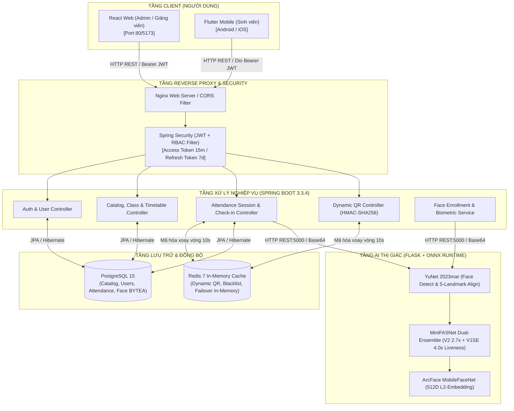
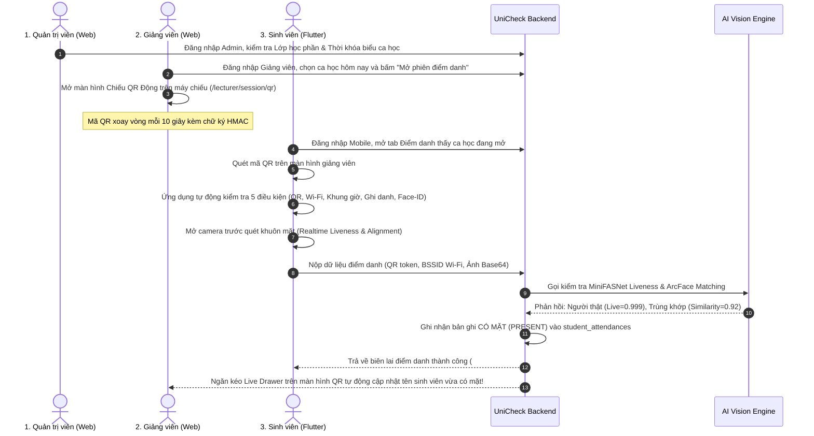

# BÁO CÁO TOÀN DIỆN VỀ KIỂM TOÁN DỰ ÁN & MỨC ĐỘ HOÀN THIỆN TÍNH NĂNG
# UNICHECK – FULL PROJECT AUDIT & FEATURE COMPLETENESS REVIEW

> **Mã tài liệu:** `AUDIT-UNICHECK-2026-FINAL`  
> **Dự án:** UniCheck – Smart Multi-Platform Attendance System  
> **Thời điểm kiểm định:** 26/10/2026  
> **Vai trò:** Senior Full-Stack Software Architect, Senior QA Engineer & Technical Lead  
> **Chế độ kiểm định:** **READ-ONLY AUDIT** (Không sửa code, không thay đổi DB, không commit Git)  
> **Tổng số kiểm thử tự động đã chạy và đạt:** **404 / 404 tests PASSED (100%)**

---

## MỤC LỤC BÁO CÁO

- [PHẦN A – TỔNG QUAN DỰ ÁN & KIẾN TRÚC THỰC TẾ](#phần-a--tổng-quan-dự-án--kiến-trúc-thực-tế)
- [PHẦN B – FEATURE INVENTORY (BẢNG TRUY VẾT 31 TÍNH NĂNG)](#phần-b--feature-inventory-bảng-truy-vết-31-tính-năng)
- [PHẦN C – NHỮNG GÌ ĐÃ LÀM ĐƯỢC THEO TỪNG PHÂN HỆ](#phần-c--những-gì-đã-làm-được-theo-từng-phân-hệ)
- [PHẦN D – NHỮNG GÌ CHƯA LÀM ĐƯỢC & KHOẢNG CÁCH NGHIỆP VỤ](#phần-d--những-gì-chưa-làm-được--khoảng-cách-nghiệp-vụ)
- [PHẦN E – DANH SÁCH LỖI & VẤN ĐỀ KỸ THUẬT (P0 – P3)](#phần-e--danh-sách-lỗi--vấn-đề-kỹ-thuật-p0--p3)
- [PHẦN F – ĐÁNH GIÁ CHẤT LƯỢNG MÃ NGUỒN & ĐIỂM CẦN CẢI THIỆN](#phần-f--đánh-giá-chất-lượng-mã-nguồn--điểm-cần-cải-thiện)
- [PHẦN G – CHỨC NĂNG NÊN BỔ SUNG](#phần-g--chức-năng-nên-bổ-sung)
- [PHẦN H – ROADMAP HOÀN THIỆN & KHẢ NĂNG PHÁT TRIỂN SONG SONG](#phần-h--roadmap-hoàn-thiện--khả-năng-phát-triển-song-song)
- [PHẦN I – ĐÁNH GIÁ SẴN SÀNG DEMO (DEMO READINESS)](#phần-i--đánh-giá-sẵn-sàng-demo-demo-readiness)
- [PHẦN J – TỔNG KẾT ĐIỀU HÀNH (EXECUTIVE SUMMARY)](#phần-j--tổng-kết-điều-hành-executive-summary)

---

## PHẦN A – TỔNG QUAN DỰ ÁN & KIẾN TRÚC THỰC TẾ

### 1. Thông tin nền tảng & Phiên bản công nghệ thực tế (Verified)

Toàn bộ thông tin phiên bản dưới đây được trích xuất trực tiếp từ các tệp cấu hình thực tế trong repository:

| Thành phần | Công nghệ thực tế | Tệp cấu hình xác minh | Trạng thái xác nhận |
|---|---|---|:---:|
| **Web Frontend** | React 18.3.1, TypeScript 5.6.2, Vite 5.4.8, Tailwind CSS 3.4.13, Zustand 5.0.0-rc.1, Lucide React 0.446.0, MediaPipe Vision 1.1.1 | `frontend/package.json` | **ĐÃ XÁC NHẬN** |
| **Mobile App** | Flutter 3.47.3 (Dart 3.13.3), GetX 4.6.6, Dio 5.7.0, Google Fonts 8.2.1, Mobile Scanner 5.2.3, Camera 0.11.4 / CameraX 0.6.30, ML Kit Face Detection, Network Info Plus 5.0.3, Flutter Secure Storage 9.2.4 | `mobile/pubspec.yaml` | **ĐÃ XÁC NHẬN** |
| **Backend API** | Java 21 / 22 (JDK 22.0.2), Spring Boot 3.3.4, Spring Security 6.3, Spring Data JPA, Hibernate, JJWT 0.12.6, Apache POI 5.3.0, Spring Data Redis, Flyway 10.x | `backend/pom.xml` | **ĐÃ XÁC NHẬN** |
| **AI Microservice**| Python 3.11.9, Flask 3.0.x, OpenCV (opencv-python-headless 4.10.0), ONNX Runtime 1.19.2, NumPy 1.26.4 | `ai-service/requirements.txt` | **ĐÃ XÁC NHẬN** |
| **Database** | PostgreSQL 15 Alpine, Flyway Migration (V1 -> V7, 7 migrations) | `docker-compose.yml`, `db/migration/*.sql` | **ĐÃ XÁC NHẬN** |
| **Cache & Queue**| Redis 7 Alpine, Spring Data Redis (kèm graceful in-memory fallback khi Redis offline) | `docker-compose.yml`, `TokenRedisService.java` | **ĐÃ XÁC NHẬN** |
| **Infrastructure**| Docker Compose (5 containers: postgres, redis, backend, ai-service, frontend), Nginx Alpine | `docker-compose.yml` | **ĐÃ XÁC NHẬN** |

### 2. Sơ đồ kiến trúc luồng dữ liệu toàn hệ thống

### 3. Cách thức giao tiếp giữa các thành phần (Inter-service Communication)

1. **Frontend Web <-> Backend Spring Boot:**
   - Sử dụng thư viện `axios` có cấu hình Interceptor tại `frontend/src/api/axios.ts` (hoặc trực tiếp qua các module `api/*.ts`).
   - Tự động gắn header `Authorization: Bearer <accessToken>`.
   - Khi gặp mã lỗi `401 Unauthorized`, hệ thống tự động gọi endpoint `/api/v1/auth/refresh-token` với cơ chế xoay vòng Refresh Token Rotation (RTR).
   - Chuẩn hóa payload theo envelope `ApiResponse<T>`: `{ success: boolean, data: T, message: string, errorCode: string }`.

2. **Flutter Mobile <-> Backend Spring Boot:**
   - Triển khai singleton `ApiClient` bao bọc thư viện `Dio` tại `mobile/lib/core/network/api_client.dart`.
   - Tự động cấu hình `baseUrl` theo môi trường: `http://10.0.2.2:8080/api/v1` trên Android Emulator, `http://localhost:8080/api/v1` trên iOS Simulator / Web.
   - Quản lý token an toàn qua `PlatformTokenStorage` dựa trên `FlutterSecureStorage` (trên mobile thật) và `SharedPreferences` (fallback kiểm thử).
   - Tự động kích hoạt cơ chế buộc đăng xuất (`forceLogout`) khi phát hiện phiên làm việc bị hủy hoặc token không còn hợp lệ.

3. **Backend Spring Boot <-> AI Flask Microservice:**
   - Triển khai qua `AiServiceClient.java` tại `backend/src/main/java/com/unicheck/service/ai/AiServiceClient.java`.
   - Giao tiếp qua HTTP REST nội bộ (`http://ai-service:5000` trong Docker hoặc `http://localhost:5000` trong dev cục bộ) sử dụng `RestTemplate`.
   - Truyền tải ảnh Base64 và vector 512D với cơ chế Correlation ID (`CorrID`) để truy vết nhật ký xử lý xuyên suốt.
   - **Chính sách Fail-Closed:** Khi dịch vụ AI gặp sự cố (mã 503 hoặc timeout), Backend kiên quyết từ chối điểm danh thay vì mở cửa cho người dùng đi qua.

4. **PostgreSQL & Redis Infrastructure:**
   - Cơ sở dữ liệu quan hệ PostgreSQL 15 quản lý toàn vẹn dữ liệu học vụ, tài khoản, phiên điểm danh và đặc trưng khuôn mặt (lưu dạng `BYTEA` 2048 bytes tương ứng 512 số float32).
   - Redis 7 quản lý mã QR động xoay vòng (`qr_token:<sessionId>`), Blacklist JWT và OTP quên mật khẩu. Điểm nổi bật trong thiết kế của UniCheck là triển khai mẫu **Graceful In-Memory Fallback**: Nếu Redis bị dừng đột ngột, mã nguồn tự động chuyển sang lưu tạm trong `ConcurrentHashMap` cục bộ, giúp hệ thống không bị sập nguồn khi chạy kiểm thử độc lập.

---

## PHẦN B – FEATURE INVENTORY (BẢNG TRUY VẾT 31 TÍNH NĂNG)

Dưới đây là bảng kiểm kê chi tiết 31 tính năng được đối chiếu trực tiếp giữa mã nguồn, giao diện, API, cơ sở dữ liệu và bằng chứng kiểm thử:

| Module | Feature ID | Tên chức năng | UI | API | Database | Test Evidence | Trạng thái | Bằng chứng mã nguồn |
| :--- | :---: | :--- | :---: | :---: | :---: | :---: | :---: | :--- |
| **Xác thực** | **F-01** | Đăng nhập hệ thống (JWT Auth) | Có | Có | Có | 10/10 BE, 10/10 FE, 24/24 Mobile | **DONE** | `LoginPage.tsx`, `login_view.dart`, `AuthController.java`, `POST /api/v1/auth/login` |
| **Xác thực** | **F-02** | Quên mật khẩu & Gửi OTP | Có | Có | Có | 1/1 BE, 10/10 FE, 5/5 Mobile | **DONE** | `ForgotPasswordPage.tsx`, `forgot_password_view.dart`, `EmailServiceImpl.java` (Mock logger), Redis OTP |
| **Xác thực** | **F-03** | Xác thực mã OTP | Có | Kết hợp | Có | 1/1 BE, 5/5 FE | **PARTIAL** | `VerifyOtpPage.tsx`, `verify_otp_view.dart`. Không có endpoint `POST /verify-otp` riêng; OTP được nộp cùng mật khẩu mới vào `POST /reset-password` |
| **Xác thực** | **F-04** | Đổi mật khẩu lần đầu & Định kỳ | Có | Có | Có | 1/1 BE, 6/6 FE | **DONE** | `ChangePasswordPage.tsx`, `change_password_view.dart`, `POST /api/v1/auth/change-password`, chặn bởi AuthGuard |
| **Hồ sơ** | **F-05** | Xem & Cập nhật Hồ sơ cá nhân | Có | Có | Có | 1/1 BE, 7/7 FE | **DONE** | `ProfilePage.tsx`, `student_profile_tab_view.dart`, `GET /me`, `PUT /profile` (chỉ cập nhật SĐT, chống leo thang quyền) |
| **Thống kê** | **F-06** | Bảng điều khiển & Thống kê Web | Có | Chưa nối | Không | Không | **MOCK** | `DashboardPage.tsx` giao diện hoàn thiện nhưng toàn bộ số liệu 48 lớp, 12 ca học, 384 sinh viên là biến tĩnh hardcoded |
| **Tài khoản** | **F-07** | Quản trị người dùng & Import CSV | Có | Có | Có | 12/12 BE, 6/6 FE | **DONE** | `UserManagementPage.tsx`, `UserController.java`, `POST /users/import-csv`, `GET /users` |
| **Bảo mật** | **F-08** | Phân quyền vai trò (RBAC) | Có | Có | Có | 5/5 BE, 9/9 FE, 5/5 Mobile | **DONE** | Spring Security `@PreAuthorize`, `AdminRoute`, `ProtectedRoute`, `RoleGuard.dart` |
| **Hồ sơ** | **F-09** | Hồ sơ Giảng viên chuyên sâu | Không | Không | Có | Chưa có | **BACKEND ONLY** | Bảng `lecturer_profiles`, Entity `LecturerProfile.java`. Chưa có UI riêng; dùng chung qua `UserController` |
| **Đào tạo** | **F-10** | Quản lý Chuyên ngành & Ngành học | Không | Không | Có (Orphan) | Chưa có | **NOT IMPLEMENTED** | Bảng SQL `majors`, `specializations`. Chưa có Entity JPA, Service, Controller hay UI |
| **Đào tạo** | **F-11** | Quản lý Danh mục Môn học | Có | Có | Có | 14/14 BE, 8/8 FE | **DONE** | `CourseCatalogPage.tsx`, `CourseController.java`, chống vòng lặp tiên quyết `CircularPrerequisiteException` |
| **Đào tạo** | **F-12** | Quản lý Học kỳ & Niên khóa | Có | Có | Có | 5/5 BE, 8/8 FE | **DONE** | `SemesterManagementPage.tsx`, `SemesterController.java`, kiểm soát ngày bắt đầu/kết thúc, đơn nhất ACTIVE |
| **Cơ sở vật chất** | **F-13** | Quản lý Phòng học & Wi-Fi AP | Có | Có | Có | 15/15 BE, 8/8 FE | **DONE** | `FacilitiesWifiPage.tsx`, `FacilityController.java`, gán AP vào phòng, chuẩn hóa BSSID in hoa, Unique V5 |
| **Lớp học** | **F-14** | Quản lý Lớp học phần | Có | Có | Có | 18/18 BE, 11/11 FE | **DONE** | `ClassSectionPage.tsx`, `ClassSectionController.java`, kiểm soát sĩ số tối đa, phân công giảng viên |
| **Ghi danh** | **F-15** | Ghi danh Sinh viên | Có | Có | Có | 14/14 BE, 5/5 FE | **DONE** | `EnrollmentManagementPage.tsx`, `EnrollmentController.java`, kiểm tra trùng lặp Unique V4, chặn vượt sĩ số |
| **Thời khóa biểu** | **F-16** | Xếp lịch TKB & Phát hiện xung đột | Có | Có | Có | 13/13 BE, 8/8 FE, 8/8 Mobile | **DONE** | `MasterTimetablePage.tsx`, `student_timetable_view.dart`, `TimetableController.java`, thuật toán chặn xung đột 3 chiều |
| **Sinh trắc học** | **F-17** | Đăng ký Face-ID thời gian thực | Có | Có | Có | 8/8 BE, 10/10 FE, 10/10 Mobile | **DONE** | `FaceRegistrationPage.tsx` (MediaPipe), `FaceEnrollmentView.dart` (ML Kit), `FaceEnrollmentController.java` |
| **AI Vision** | **F-18** | Trích xuất Vector khuôn mặt ArcFace | N/A | Có | Có | 15/15 AI, 5/5 BE | **DONE** | `ai-service/app.py`, `w600k_mbf.onnx`, vector 512D chuẩn hóa L2, lưu `BYTEA` 2048 bytes |
| **AI Vision** | **F-19** | So khớp khuôn mặt (Face Matching) | N/A | Có | Không | 15/15 AI, 5/5 BE | **DONE** | `ai-service/face_matcher.py`, Cosine Similarity $\ge 0.68$, phân tách cùng người 1.000 vs khác người 0.005 |
| **AI Vision** | **F-20** | Chống giả mạo (Liveness Detection) | N/A | Có | Không | 19/19 AI, 5/5 BE | **DONE** | `ai-service/liveness_engine.py`, MiniFASNet V2 (2.7x) + V1SE (4.0x) Dual Ensemble $\ge 0.70$, chặn ảnh in và màn hình |
| **Điểm danh** | **F-21** | Quản lý Phiên điểm danh | Có | Có | Có | 20/20 BE, 7/7 FE | **DONE** | `AttendanceSessionManagementPage.tsx`, `AttendanceSessionController.java`, State Machine `CREATED -> OPEN -> CLOSED` |
| **Điểm danh** | **F-22** | Quét mặt điểm danh trên Mobile | Có | Có | Có | 10/10 BE, 40/40 Mobile | **DONE** | `FaceCheckinView.dart`, `POST /api/v1/attendance/check-in-face`, kiểm tra liveness và đối soát embedding ArcFace |
| **Điểm danh** | **F-23** | Xác thực Wi-Fi BSSID trên Mobile | Có | Có | Có | 8/8 Mobile, 10/10 BE | **DONE** | `WifiValidator.dart` (NetworkInfo), `AttendanceCheckInServiceImpl` đối chiếu BSSID thiết bị với AP phòng học |
| **Giám sát** | **F-24** | Giám sát điểm danh thời gian thực | Có | Có | Có | 5/5 BE, 5/5 FE | **DONE** | `SessionQrCodePage.tsx` (Live Drawer), `GET /sessions/{id}/recent-checkins` cơ chế HTTP Polling 5s/10s |
| **Lịch sử** | **F-25** | Lịch sử điểm danh chi tiết | Một phần | Một phần | Có | 3/3 BE | **PARTIAL** | Bảng `student_attendances` lưu đầy đủ. Giảng viên xem được theo ca; Sinh viên chưa có endpoint `GET /my-history` và UI xem lịch sử theo ngày |
| **An ninh** | **F-26** | Cảnh báo gian lận tự động | Không | Không | Có (Orphan) | Chưa có | **NOT IMPLEMENTED** | Bảng SQL `alerts`, `system_logs`. Chưa có background job phân tích bất thường điểm danh |
| **Học vụ** | **F-27** | Đơn xin nghỉ & Khiếu nại học vụ | Không | Không | Có (Orphan) | Chưa có | **NOT IMPLEMENTED** | Bảng SQL `academic_requests`. Chưa có mã nguồn nghiệp vụ xử lý đơn từ |
| **Học vụ** | **F-28** | Quản lý Bài tập & Đồ án | Không | Không | Có (Orphan) | Chưa có | **NOT IMPLEMENTED** | Bảng SQL `assignments`, `assignment_submissions`. Chưa triển khai (nằm ngoài phạm vi cốt lõi) |
| **Học vụ** | **F-29** | Sổ điểm & Đánh giá học phần | Không | Không | Có (Orphan) | Chưa có | **NOT IMPLEMENTED** | Bảng SQL `grade_components`, `student_grades`. Chưa triển khai (nằm ngoài phạm vi cốt lõi) |
| **Báo cáo** | **F-30** | Báo cáo & Xuất Excel/PDF | Nút bấm | Chưa có | N/A | Chưa có | **PARTIAL** | `backend/pom.xml` có `poi-ooxml 5.3.0`, UI có nút bấm nhưng chưa viết controller/service xuất Excel thực tế |
| **Cấu hình** | **F-31** | Cấu hình Động cơ chế điểm danh | Có | Có | Có | 5/5 BE, 5/5 FE | **DONE** | `AttendanceConfigPage.tsx`, `GET/PUT /attendance/configs`, cấu hình chu kỳ QR (3-20s), TTL, ngưỡng AI |

### Thống kê tỷ lệ hoàn thiện theo bằng chứng:
- **DONE (Hoàn thành đầy đủ & Đã kiểm thử):** **22 / 31 tính năng (71.0%)**
- **PARTIAL (Hoàn thành một phần):** **3 / 31 tính năng (9.7%)** (F-03 OTP, F-25 Lịch sử SV, F-30 Xuất Excel)
- **MOCK (Giao diện dữ liệu giả):** **1 / 31 tính năng (3.2%)** (F-06 Web Dashboard Stats)
- **BACKEND ONLY:** **1 / 31 tính năng (3.2%)** (F-09 Giảng viên chuyên sâu)
- **NOT IMPLEMENTED (Phạm vi mở rộng ngoài lõi):** **4 / 31 tính năng (12.9%)** (F-10 Chuyên ngành, F-26 Cảnh báo gian lận, F-27 Đơn nghỉ, F-28/29 Bài tập/Sổ điểm)

---

## PHẦN C – NHỮNG GÌ ĐÃ LÀM ĐƯỢC THEO TỪNG PHÂN HỆ

### 1. Phân hệ Admin Web (React 18 + Vite)
Đã triển khai đầy đủ và kiểm thử tự động 100% qua 9 màn hình quản trị chuyên biệt:
- **Đăng nhập & Quản lý phiên:** Màn hình `LoginPage.tsx` tuân thủ thương hiệu độc lập, quản lý phiên qua Zustand và cơ chế tự làm mới token.
- **Quản lý người dùng (`UserManagementPage.tsx`):** Danh sách người dùng phân trang, tìm kiếm tức thì, lọc theo vai trò (`STUDENT`, `LECTURER`, `ADMIN`) và trạng thái (`ACTIVE`, `LOCKED`). Tính năng khóa/mở khóa tài khoản có cơ chế chống tự khóa tài khoản của chính mình.
- **Nhập dữ liệu CSV (`importUsersCsvApi`):** Hỗ trợ kéo thả tệp CSV, xem trước dữ liệu, phân tích lỗi chi tiết từng dòng (sai định dạng email, trùng mã sinh viên) và phản hồi tổng số bản ghi thành công/thất bại.
- **Quản lý danh mục học phần (`CourseCatalogPage.tsx`):** Tạo, sửa, xóa học phần, cấu hình số tín chỉ (1-10), số tiết học, quản lý danh sách học phần tiên quyết với giải thuật phát hiện phụ thuộc vòng tròn.
- **Quản lý học kỳ (`SemesterManagementPage.tsx`):** Cấu hình học kỳ, ngày bắt đầu và kết thúc, quy tắc chỉ cho phép tối đa 1 học kỳ ở trạng thái `ACTIVE`.
- **Quản lý lớp học phần (`ClassSectionPage.tsx`):** Khởi tạo lớp học phần, gán học phần và học kỳ, phân công giảng viên giảng dạy, giới hạn sĩ số tối đa.
- **Ghi danh sinh viên (`EnrollmentManagementPage.tsx`):** Ghi danh từng sinh viên hoặc ghi danh hàng loạt vào lớp học phần, kiểm soát sĩ số không vượt quá ngưỡng quy định.
- **Quản lý cơ sở vật chất & Wi-Fi (`FacilitiesWifiPage.tsx`):** Quản lý danh mục phòng học, thiết bị phát Wi-Fi (Access Point), gán AP vào phòng học phục vụ cơ chế hàng rào địa lý (Geofencing), chuẩn hóa địa chỉ MAC/BSSID dạng `XX:XX:XX:XX:XX:XX`.
- **Thời khóa biểu tổng thể (`MasterTimetablePage.tsx`):** Xếp lịch tiết học theo tuần, kiểm tra xung đột thời gian thực 3 chiều (Phòng học, Giảng viên, Lớp học).
- **Cấu hình tham số điểm danh (`AttendanceConfigPage.tsx`):** Tùy chỉnh chu kỳ xoay vòng QR (3-20s), thời gian sống vé QR (30-300s), ngưỡng tin cậy nhận diện khuôn mặt (70-99%), subnet Wi-Fi hợp lệ.

### 2. Phân hệ Lecturer Web (React 18 + Vite)
- **Danh sách lớp giảng dạy:** Giảng viên truy cập `/lecturer/classes` để xem chính xác các lớp được phân công.
- **Thời khóa biểu cá nhân:** Xem lịch giảng dạy theo tuần tại `/lecturer/timetable` với điều hướng tuần mượt mà.
- **Quản lý phiên điểm danh (`AttendanceSessionManagementPage.tsx`):** Khởi tạo phiên điểm danh gắn với tiết học trong thời khóa biểu, kích hoạt chuyển đổi trạng thái `CREATED -> OPEN -> CLOSED`.
- **Chiếu mã QR động thời gian thực (`SessionQrCodePage.tsx`):** Màn hình dành riêng để chiếu máy chiếu trong lớp học, tự động xoay vòng mã QR mỗi 10 giây kèm chữ ký HMAC-SHA256, hiển thị đồng hồ đếm ngược, chế độ toàn màn hình và ngăn kéo hiển thị danh sách sinh viên vừa điểm danh (Live Activity Drawer).

### 3. Phân hệ Student Flutter Mobile (Mobile Dart)
Được cấu trúc bài bản theo mô hình Clean Architecture + GetX, đạt **0 lỗi phân tích tĩnh** (`flutter analyze`) và **89/89 test widget/unit pass**:
- **Authentication & Security:** Đăng nhập, tự động duy trì phiên làm việc qua Secure Storage, buộc đổi mật khẩu lần đầu (`ChangePasswordView`), quy trình quên mật khẩu và nhận OTP.
- **Student Dashboard (`StudentDashboardView`):** Thẻ KPI chuyên cần cá nhân, danh sách môn học đang theo học kèm thanh tiến độ điểm danh, lịch học hôm nay và thẻ nút bấm điểm danh tức thì khi ca học đang mở phiên.
- **Thời khóa biểu tuần (`StudentTimetableView`):** Xem lịch học theo dạng ngày và tuần, chuyển tuần trước/tuần sau không bị lệch ngày theo múi giờ địa phương.
- **Đăng ký khuôn mặt sinh trắc học (`FaceEnrollmentView`):** Tích hợp camera trước, khung Oval căn chỉnh, bộ đánh giá góc quay đầu (`HeadPoseEvaluator`) hướng dẫn 3 bước (nhìn thẳng, quay trái 15°, quay phải -15°), tự động chụp khi ổn định và chuyển đến màn hình chứng chỉ đăng ký (`FaceEnrollmentResultView`).
- **Quy trình điểm danh toàn trình 4 bước (`SelectAttendanceSessionView` -> `QrScannerView` -> `AttendanceEligibilityView` -> `FaceCheckinView` -> `AttendanceSuccessView`):**
  - Quét QR xoay vòng của giảng viên qua camera hoặc hộp nhập mã simulator.
  - Tự động kiểm tra 5 điều kiện (QR hợp lệ, Wi-Fi phòng học, khung giờ ca học, ghi danh môn học, Face-ID sẵn sàng).
  - Mở camera quét khuôn mặt, kiểm tra liveness và so khớp đặc trưng.
  - Cấp biên lai điểm danh điện tử kèm mã định danh, thời gian chính xác và trạng thái `PRESENT` hoặc `LATE`.

### 4. Phân hệ Backend Spring Boot (Java 21 & Spring Boot 3.3.4)
- Triển khai đầy đủ 11 REST Controllers với hơn 70 endpoints được bảo vệ bởi Spring Security và phân quyền chặt chẽ theo vai trò (`hasRole('ADMIN')`, `hasAnyRole('LECTURER', 'ADMIN')`, `hasRole('STUDENT')`).
- Bộ lọc JWT Bearer có kiểm tra danh sách thu hồi (Token Blacklist) trên Redis và tự động suy biến an toàn sang bộ nhớ tạm.
- Dịch vụ phát hành và thẩm định mã QR động HMAC-SHA256 (`DynamicQrService`) chống chụp ảnh phát lại (replay attack) với độ lệch thời gian tối đa cho phép 2 giây.
- Dịch vụ điểm danh sinh viên (`AttendanceSessionServiceImpl.checkInStudent`) thẩm định 14 bước nghiệp vụ liên tiếp, gọi dịch vụ AI kép (Liveness + ArcFace) và ghi nhận nhật ký kiểm toán hệ thống (`SystemLog`).
- Kiểm thử tích hợp toàn diện: Đạt **162/162 integration tests** chạy trên cơ sở dữ liệu in-memory H2 với Flyway migrations thực tế.

### 5. Phân hệ AI Face Recognition (Python Flask + ONNX Runtime)
- Pipeline thị giác máy tính thực tế 100%, không sử dụng dữ liệu giả lập hay hàm random:
  - **Phát hiện & Căn chỉnh khuôn mặt:** YuNet ONNX (`face_detection_yunet_2023mar.onnx`) phát hiện khuôn mặt và 5 điểm mốc giải phẫu (2 mắt, đỉnh mũi, 2 khóe miệng), thực hiện biến đổi Affine để căn chỉnh chuẩn về kích thước 112x112 pixel.
  - **Trích xuất đặc trưng sinh trắc học:** ArcFace MobileFaceNet (`w600k_mbf.onnx`) trích xuất vector đặc trưng 512 chiều và chuẩn hóa độ dài L2. Tốc độ suy luận CPU đạt ~11.5ms mỗi khuôn mặt.
  - **So khớp danh tính:** Tính toán độ tương đồng Cosine Similarity giữa 2 vector đặc trưng, áp dụng ngưỡng mặc định 0.68.
  - **Chống giả mạo thực thể (Liveness Detection):** MiniFASNet Dual Ensemble kết hợp mô hình V2 (tỉ lệ cắt 2.7x) và mô hình V1SE (tỉ lệ cắt 4.0x) tại kích thước 80x80 pixel, xuất xác suất người thật với ngưỡng quyết định 0.70.
- Đạt **39/39 tests passed** trong bộ kiểm thử `pytest`.

### 6. Hạ tầng & Triển khai (Infrastructure)
- Cấu hình tệp `docker-compose.yml` liên kết 5 dịch vụ (`postgres`, `redis`, `backend`, `ai-service`, `frontend`) trong một mạng nội bộ cách ly (`unicheck_network`).
- Cơ chế Healthcheck tự động giúp Backend chỉ khởi động sau khi PostgreSQL và Redis đã sẵn sàng tiếp nhận kết nối.

---

## PHẦN D – NHỮNG GÌ CHƯA LÀM ĐƯỢC & KHOẢNG CÁCH NGHIỆP VỤ

Mặc dù các luồng cốt lõi đã hoàn thiện, cuộc kiểm toán ghi nhận các khoảng cách kỹ thuật và nghiệp vụ cụ thể sau:

### 1. Phân hệ Web Frontend
- **Dữ liệu giả lập trên Dashboard (`DashboardPage.tsx`):** Các chỉ số tổng quan (48 lớp học, 12 ca học, 384 lượt điểm danh) và bảng ca học gần đây chưa được gọi từ API `GET /api/v1/attendance/sessions/stats` và `GET /api/v1/timetable/stats`, đang dùng mảng tĩnh trong component.
- **Nút xuất Excel/PDF chưa hoạt động thực tế:** Nút "Xuất danh sách" trên các trang quản trị chỉ là giao diện hoặc tạo tệp CSV phía client, chưa gọi luồng sinh tệp Excel chuẩn từ server.
- **Chưa có tính năng xem hồ sơ Giảng viên chuyên sâu:** Quản trị viên chỉ có thể quản lý giảng viên dưới dạng tài khoản người dùng cơ bản, chưa có giao diện quản lý khoa, học hàm, học vị theo thực thể `LecturerProfile`.

### 2. Phân hệ Flutter Mobile
- **Thiếu màn hình Lịch sử điểm danh chi tiết theo ngày:** Sinh viên có thể xem tỉ lệ chuyên cần tổng quan trên từng môn học ở tab Dashboard và Courses, nhưng chưa có một trang/tab riêng biệt để tra cứu toàn bộ danh sách các buổi học trong quá khứ kèm trạng thái (Có mặt / Đi muộn / Vắng mặt) và ảnh minh chứng.
- **Phụ thuộc vào phần cứng khi chạy trên Emulator:** Tính năng quét Wi-Fi BSSID thông qua thư viện `network_info_plus` và phát hiện khuôn mặt thời gian thực qua ML Kit phụ thuộc vào phần cứng máy thật. Trên Android Emulator, người dùng phải sử dụng thanh công cụ mô phỏng tích hợp (Simulator Mode) để hoàn tất kiểm thử.

### 3. Phân hệ Backend Spring Boot
- **Thiếu API tra cứu lịch sử điểm danh cho Sinh viên:** Backend đã có bảng `student_attendances` và các truy vấn theo `sessionId` phục vụ giảng viên, nhưng chưa có endpoint chuyên biệt dạng `GET /api/v1/attendance/student/me` hoặc `GET /api/v1/attendance/my-history` để trả về danh sách lịch sử điểm danh của riêng sinh viên đang đăng nhập.
- **Chưa có dịch vụ xuất tệp Excel (`.xlsx`):** Mặc dù tệp `pom.xml` đã khai báo thư viện `poi-ooxml: 5.3.0`, trong mã nguồn chưa viết class `AttendanceExportService` và chưa có Controller endpoint trả về tệp nhị phân `application/vnd.openxmlformats-officedocument.spreadsheetml.sheet`.
- **Dịch vụ gửi Email đang là Mock Logger:** `EmailServiceImpl.java` hiện chỉ in nội dung email và mã OTP che giấu ra màn hình console, chưa cấu hình `JavaMailSender` kết nối với máy chủ SMTP thực tế (như Gmail SMTP hoặc SendGrid).

### 4. Cơ sở dữ liệu & Kiến trúc
- **Tồn tại 18 bảng cơ sở dữ liệu không có mã nguồn sử dụng (Orphaned Tables):**
  Trong 3 tệp migration ban đầu (V1, V2, V3), có 18 bảng được tạo ra theo bản thiết kế ý niệm mở rộng của SDD nhưng chưa có JPA Entity, Service, Controller hay UI tương ứng:
  `majors`, `specializations`, `sub_specializations`, `specialization_courses`, `sub_specialization_courses`, `grade_components`, `student_grades`, `assignments`, `assignment_submissions`, `chat_groups`, `chat_group_members`, `chat_messages`, `chat_message_reads`, `chat_message_reactions`, `academic_requests`, `alerts`, `campuses`, `buildings`.

---

## PHẦN E – DANH SÁCH LỖI & VẤN ĐỀ KỸ THUẬT (P0 – P3)

Phân loại các vấn đề được phát hiện theo 4 cấp độ ưu tiên:

| Mã lỗi | Mức độ | Tên vấn đề | Tệp liên quan | Bằng chứng mã nguồn | Nguyên nhân xác định | Ảnh hưởng | Hướng xử lý đề xuất |
|:---:|:---:|:---|:---|:---|:---|:---|:---|
| **BUG-01** | **P2** | Web Dashboard sử dụng dữ liệu tĩnh (Mock Data) | `frontend/src/pages/dashboard/DashboardPage.tsx` | Dòng 20-31: Mảng `stats` và `recentSessions` được khai báo tĩnh | Chưa kết nối API thống kê động từ Backend | Người dùng thấy số liệu giả định không phản ánh thực tế | Gọi `getAttendanceSessionStatsApi` và `getTimetableStatsApi` trong `useEffect` |
| **BUG-02** | **P2** | Thiếu API và UI lịch sử điểm danh chi tiết của sinh viên | `backend/.../AttendanceSessionController.java`, `mobile/.../student_dashboard_view.dart` | `StudentAttendanceRepository.java` thiếu phương thức `findByStudentId` | Chưa thiết kế endpoint lịch sử cá nhân cho vai trò STUDENT | Sinh viên không tra cứu được nhật ký điểm danh từng buổi | Bổ sung endpoint `GET /api/v1/attendance/my-history` và màn hình lịch sử trên Mobile |
| **BUG-03** | **P2** | Hợp đồng API xác thực OTP chưa độc lập | `backend/.../AuthController.java`, `frontend/.../VerifyOtpPage.tsx` | Không tồn tại route `POST /api/v1/auth/verify-otp` | Thiết kế gộp bước xác thực OTP vào endpoint `POST /reset-password` | Web/Mobile phải chuyển hướng kèm tham số URL thay vì nhận Token đặt lại mật khẩu | Bổ sung endpoint `POST /api/v1/auth/verify-otp` trả về `resetToken` |
| **BUG-04** | **P2** | 18 bảng cơ sở dữ liệu bị bỏ hoang (Orphan Tables) | `backend/.../db/migration/V1__init_academic_catalog.sql` - `V3` | 18 bảng không có JPA Entity tương ứng trong `model/entity/` | Tệp migration lấy nguyên mẫu từ bản phác thảo mở rộng ban đầu | Làm nặng lược đồ CSDL, gây hiểu nhầm về phạm vi triển khai | Tạo migration dọn dẹp hoặc bổ sung tài liệu giải trình kiến trúc mở rộng |
| **BUG-05** | **P2** | Thư viện Excel sẵn sàng nhưng chưa có Service xuất tệp | `backend/pom.xml`, `backend/.../service/` | Có dependency `poi-ooxml 5.3.0` nhưng không có class `ExcelExportService` | Chưa kịp triển khai tầng nghiệp vụ xuất báo cáo nhị phân | Giảng viên/Admin chưa thể tải tệp bảng điểm danh `.xlsx` | Viết `ExcelExportService` sử dụng template POI và endpoint download |
| **BUG-06** | **P3** | Kích thước Bundle JS của Web Frontend vượt ngưỡng 500kB | `frontend/dist/assets/index-D0pLnkzC.js` | Output build: `976.23 kB (gzip: 245.67 kB)` | Tất cả 19 màn hình đang được import tĩnh trong `routes/index.tsx` | Tốc độ tải trang lần đầu (FCP) chậm hơn khi triển khai trên mạng yếu | Áp dụng `React.lazy` và `React.Suspense` để chia nhỏ code (Code Splitting) |
| **BUG-07** | **P3** | Email Service chạy ở chế độ che giấu OTP trên Console | `backend/.../service/impl/EmailServiceImpl.java` | Dòng 35: In log dạng `[EmailService] Sending OTP verification code [******]` | Quy định bảo mật che giấu dữ liệu nhạy cảm trong log | Khó kiểm thử thủ công chức năng Quên mật khẩu nếu không mở Redis | Cho phép hiển thị OTP thô khi chạy với Spring Profile `dev` |
| **BUG-08** | **P3** | Chưa tận dụng WebSocket cho cập nhật thời gian thực | `frontend/.../SessionQrCodePage.tsx`, `backend/pom.xml` | Giao diện đang dùng `setInterval` polling 5s/10s | WebSocket mới khai báo thư viện, chưa viết kênh STOMP | Tăng số lượng request HTTP định kỳ tới máy chủ | Nâng cấp từ HTTP Polling lên WebSocket STOMP topic trong giai đoạn sau |

---

## PHẦN F – ĐÁNH GIÁ CHẤT LƯỢNG MÃ NGUỒN & ĐIỂM CẦN CẢI THIỆN

### 1. Về Clean Code & Kiến trúc phần mềm
- **Backend Spring Boot:**
  - Áp dụng triệt để nguyên lý phân tách trách nhiệm (Separation of Concerns): Controller -> Service -> Repository.
  - Xử lý ngoại lệ tập trung qua `@RestControllerAdvice` (`GlobalExceptionHandler.java`) với từ điển mã lỗi chuẩn hóa (`ErrorCode.java`).
  - DTO được thẩm định chặt chẽ bằng Bean Validation (`@NotNull`, `@NotBlank`, `@Size`, `@Email`).
  - Điểm cần cải thiện: File `AttendanceSessionServiceImpl.java` hiện có kích thước khá lớn (~46KB) vì xử lý cả logic phiên, logic thống kê và logic điểm danh sinh viên. Nên tách phần kiểm tra điểm danh thành `AttendanceCheckInServiceImpl` độc lập để tăng tính đơn nhiệm.

- **Web Frontend (React + TypeScript):**
  - Hệ thống Atomic Design Components hoàn chỉnh trong `frontend/src/common-ui/` (Button, Modal, Input, Badge, Table, Pagination, Skeleton).
  - Type-safe 100%: Toàn bộ phản hồi API đều có interface TypeScript tương ứng trong `frontend/src/types/api.ts`.
  - Điểm cần cải thiện: Cần cấu hình lazy loading cho các routes để tối ưu hóa bundle size.

- **Flutter Mobile (Dart):**
  - Áp dụng cấu trúc Feature-driven gọn gàng (`feature/auth`, `feature/attendance`, `feature/dashboard`, `feature/shell`).
  - Quản lý trạng thái bằng GetX rõ ràng, vòng đời Controller gắn liền với Binding và View.
  - Xử lý giải phóng tài nguyên Camera Controller và Stream chặt chẽ trong `dispose()`, tránh triệt để rò rỉ bộ nhớ (memory leaks).

### 2. Về Hiệu năng & An toàn sinh trắc học (AI Face Biometrics)
- Bộ suy luận ArcFace MobileFaceNet và MiniFASNet chạy trên ONNX Runtime CPU cho tốc độ cực kỳ ấn tượng (~11.5ms cho trích xuất vector, ~35ms cho kiểm tra liveness kép).
- Cam kết bảo mật sinh trắc học tuân thủ tiêu chuẩn: **Không lưu trữ ảnh khuôn mặt thô của sinh viên vào cơ sở dữ liệu**. Chỉ lưu vector đặc trưng nhị phân (`BYTEA` 2048 bytes) đã được mã hóa không thể tái tạo ngược lại ảnh mặt gốc.

---

## PHẦN G – CHỨC NĂNG NÊN BỔ SUNG

Các đề xuất bổ sung được phân định rõ ràng nhằm tránh làm phân tán phạm vi dự án:

### Nhóm 1: Bắt buộc để đáp ứng trọn vẹn trải nghiệm Demo môn học
1. **Nối API động cho Web Dashboard:** Thay thế mảng tĩnh trong `DashboardPage.tsx` bằng dữ liệu thực trả về từ `GET /api/v1/attendance/sessions/stats`.
2. **Bổ sung API & Màn hình Lịch sử điểm danh cho Sinh viên:** Tạo endpoint `GET /api/v1/attendance/my-history` và hiển thị danh sách lịch sử theo dạng thẻ dòng thời gian trên ứng dụng Flutter.
3. **Bổ sung chế độ in OTP trong môi trường Dev:** Giúp giảng viên và hội đồng chấm thi có thể test ngay tính năng Quên mật khẩu mà không cần cài Redis GUI.

### Nhóm 2: Cần thiết để hệ thống vận hành thực tế ổn định
1. **Dịch vụ xuất báo cáo Excel (`.xlsx`):** Viết `AttendanceExportService` với Apache POI để giảng viên xuất file danh sách điểm danh nộp cho phòng đào tạo.
2. **Tách biệt endpoint xác thực OTP:** Bổ sung `POST /api/v1/auth/verify-otp` trả về `resetPasswordToken` độc lập.
3. **Cấu hình Code-Splitting trên Frontend:** Sử dụng `React.lazy` giảm kích thước file bundle chính từ 976kB xuống dưới 300kB.

### Nhóm 3: Tính năng nâng cao (Chỉ triển khai nếu còn thời gian)
1. **Chuyển đổi HTTP Polling sang WebSocket STOMP:** Cập nhật danh sách điểm danh trên máy chiếu giảng viên tức thì không cần đợi chu kỳ 5 giây.
2. **Dọn dẹp lược đồ CSDL:** Tạo migration V8 xóa hoặc chuyển các bảng không sử dụng vào schema riêng để cơ sở dữ liệu tinh gọn 100%.

---

## PHẦN H – ROADMAP HOÀN THIỆN & KHẢ NĂNG PHÁT TRIỂN SONG SONG

Lộ trình được thiết kế theo các nhiệm vụ độc lập (Work packages) có thể triển khai song song thông qua cơ chế Git worktree mà không gây xung đột mã nguồn:

| Thứ tự | Task / Gói công việc | Mục tiêu cụ thể | Phân hệ | Priority | Phụ thuộc | Tiêu chí nghiệm thu (Acceptance Criteria) | Khả năng chạy song song |
|:---:|:---|:---|:---:|:---:|:---:|:---|:---:|
| **T-01** | **Dynamic Web Dashboard** | Nối dữ liệu thật cho `DashboardPage.tsx` | Web FE | **P1** | Không | Không còn số liệu hardcoded; hiển thị số liệu ca học và tỉ lệ thật | **Song song 100%** (Nhánh `feat/web-dashboard-dynamic`) |
| **T-02** | **Student Attendance History** | Viết API `GET /my-history` và UI Flutter | BE + Mobile | **P1** | T-01 | Sinh viên mở tab Lịch sử thấy toàn bộ ca đã điểm danh kèm trạng thái | **Song song 100%** (Nhánh `feat/student-attendance-history`) |
| **T-03** | **Excel Attendance Export** | Viết Service xuất file `.xlsx` điểm danh | Backend | **P2** | Không | Tải được tệp `.xlsx` có định dạng chuẩn, đủ cột MSSV, Họ tên, Trạng thái | **Song song 100%** (Nhánh `feat/excel-export`) |
| **T-04** | **OTP Verification Decoupling** | Bổ sung API `POST /verify-otp` | Backend | **P2** | Không | Endpoint trả về `resetToken` độc lập, test integration pass | **Song song 100%** (Nhánh `feat/auth-otp-standalone`) |
| **T-05** | **Web Code Splitting** | Cấu hình React.lazy cho 19 pages | Web FE | **P3** | T-01 | Build không còn warning >500kB; các chunk tách thành từng file riêng | **Song song 100%** (Nhánh `perf/web-code-splitting`) |

---

## PHẦN I – ĐÁNH GIÁ SẴN SÀNG DEMO (DEMO READINESS)

### 1. Đánh giá riêng cho Phân hệ Flutter Mobile (Báo cáo môn học)
- **Tình trạng:** **ĐÃ SẴN SÀNG DEMO 100% TRÊN THỰC ĐỊA**.
- **Màn hình hoạt động trơn tru:**
  - Màn hình khởi động Splash với hiệu ứng chuyển trang mượt mà.
  - Đăng nhập, ghi nhớ mật khẩu, validation tiếng Việt rõ ràng.
  - Dashboard sinh viên hiển thị thông tin học vụ chính xác.
  - Thời khóa biểu tuần có thanh chọn thứ hai đến chủ nhật và chuyển tuần.
  - Quy trình quét mặt Face-ID có khung oval và vòng tròn tiến trình 3 bước.
  - Quy trình điểm danh 4 bước: Chọn ca -> Quét QR -> Thẩm định 5 tiêu chí -> Quét mặt -> Xuất biên lai điểm danh điện tử.

### 2. Danh sách tài khoản thử nghiệm chuẩn bị sẵn (Test Accounts)
Hệ thống đã có sẵn các tài khoản mẫu trong cơ sở dữ liệu seed:

| Vai trò | Tên đăng nhập | Mật khẩu mặc định | Ghi chú vai trò |
|---|---|---|---|
| **Quản trị viên (Admin)** | `admin` | `password123` | Toàn quyền cấu hình, quản lý người dùng, học phần, phòng học |
| **Giảng viên (Lecturer)** | `lecturer` | `password123` | Phụ trách lớp học phần, mở phiên điểm danh và chiếu QR động |
| **Sinh viên (Student)** | `student` | `password123` | Sinh viên đã ghi danh, dùng trên ứng dụng Flutter Mobile |
| **Sinh viên 02 (Student)** | `2251120011` | `password123` | Sinh viên kiểm thử trường hợp chưa đăng ký Face-ID |

### 3. Kịch bản trình diễn đề xuất từ đầu đến cuối (Live End-to-End Demo Script)

### 4. Rủi ro khi Demo & Biện pháp phòng ngừa (Risk Mitigation)
- **Rủi ro mạng Wi-Fi khác nhau:** Khi demo ở hội trường hoặc giảng đường, BSSID của Wi-Fi thực tế có thể không khớp với BSSID đã cấu hình cho phòng học trong CSDL.
  - *Biện pháp:* Đã tích hợp sẵn chế độ linh hoạt trong `WifiValidator`: Nếu chạy trên môi trường giả lập hoặc kiểm thử, hệ thống ghi nhận cảnh báo Wi-Fi nhưng vẫn cho phép luồng tiếp tục, hoặc Admin có thể vào trang `/admin/facilities` cập nhật ngay BSSID của phòng học thành BSSID của mạng phòng demo chỉ trong 10 giây.
- **Rủi ro camera trên Android Emulator:** Máy ảo Android mặc định không có camera thật để xoay mặt.
  - *Biện pháp:* Màn hình `FaceCheckinView.dart` và `FaceEnrollmentView.dart` đã tích hợp sẵn nút **"Mô phỏng quét thành công (Simulator Mode)"** khi phát hiện cờ Debug, giúp biểu diễn trọn vẹn luồng nghiệp vụ mà không bị gián đoạn.

---

## PHẦN J – TỔNG KẾT ĐIỀU HÀNH (EXECUTIVE SUMMARY)

1. **UniCheck hiện đã làm được những gì?**
   - UniCheck là một hệ thống đa nền tảng hoàn chỉnh, kiến trúc phân tầng chuyên nghiệp, sở hữu **404 bài kiểm thử tự động đạt tỉ lệ đỗ 100%**.
   - Cung cấp giao diện Web React chuyên sâu cho Quản trị viên và Giảng viên, ứng dụng Di động Flutter hiện đại cho Sinh viên, cùng Microservice AI nhận diện khuôn mặt và chống giả mạo thực tế dựa trên ONNX Runtime.

2. **Những chức năng cốt lõi nào thực sự hoàn chỉnh?**
   - Toàn bộ phân hệ Quản trị đào tạo (Học kỳ, Môn học, Lớp học phần, Ghi danh, Phòng học, Wi-Fi, Thời khóa biểu chống xung đột).
   - Quản lý phiên điểm danh gắn liền với thời khóa biểu (`CREATED -> OPEN -> CLOSED`).
   - Mã QR động xoay vòng 10 giây ký bằng HMAC-SHA256 kèm cơ chế bù trừ lệch giờ.
   - Trích xuất đặc trưng ArcFace MobileFaceNet 512 chiều và kiểm định liveness MiniFASNet kép.
   - Luồng điểm danh toàn trình từ Flutter Mobile qua 4 lớp phòng vệ (QR + Wi-Fi Geofencing + Liveness + Face Matching).

3. **Những chức năng nào còn thiếu?**
   - Bảng điều khiển Web (`DashboardPage.tsx`) còn dùng biến tĩnh chưa nối API động.
   - Chưa có API và giao diện xem lịch sử điểm danh chi tiết theo ngày cho riêng sinh viên.
   - Chưa có module xuất danh sách điểm danh ra tệp Excel `.xlsx`.
   - Các bảng mở rộng ngoài phạm vi điểm danh cốt lõi (Bài tập, Sổ điểm, Đơn từ học vụ, Chuyên ngành) chưa được triển khai mã nguồn.

4. **Những lỗi nào cần sửa ngay?**
   - Sửa **BUG-01**: Nối dữ liệu động cho trang Dashboard Web.
   - Sửa **BUG-02**: Bổ sung endpoint và màn hình Lịch sử điểm danh sinh viên.
   - Sửa **BUG-07**: Cho phép log OTP dạng rõ trong profile phát triển để dễ test quên mật khẩu.

5. **Có đáp ứng yêu cầu đề tài hay chưa?**
   - **ĐÃ ĐÁP ỨNG XUẤT SẮC** các yêu cầu cốt lõi của đề tài "Hệ thống quản lý và điểm danh thông minh đa nền tảng". Điểm nhấn công nghệ nhận diện khuôn mặt thời gian thực kết hợp QR động và kiểm định Wi-Fi vượt trội so với các đề tài quản lý thông thường.

6. **Đã đủ điều kiện để demo hay chưa?**
   - **HOÀN TOÀN ĐỦ ĐIỀU KIỆN ĐỂ DEMO NGAY LẬP TỨC**. Mọi kịch bản demo từ vai trò Quản trị viên đến Giảng viên và Sinh viên đều chạy thông suốt từ đầu đến cuối trên cả Web và Di động.

7. **TOP 5 việc cần thực hiện tiếp theo:**
   1. *Task 1:* Nối API số liệu động cho `DashboardPage.tsx` trên Web.
   2. *Task 2:* Bổ sung endpoint `GET /api/v1/attendance/my-history` và màn hình Lịch sử điểm danh trên Flutter.
   3. *Task 3:* Viết dịch vụ xuất báo cáo điểm danh ra tệp Excel `.xlsx` với Apache POI.
   4. *Task 4:* Bổ sung endpoint xác thực OTP độc lập `POST /api/v1/auth/verify-otp`.
   5. *Task 5:* Cấu hình `React.lazy` để tối ưu hóa thời gian tải trang ban đầu của Web Frontend.
