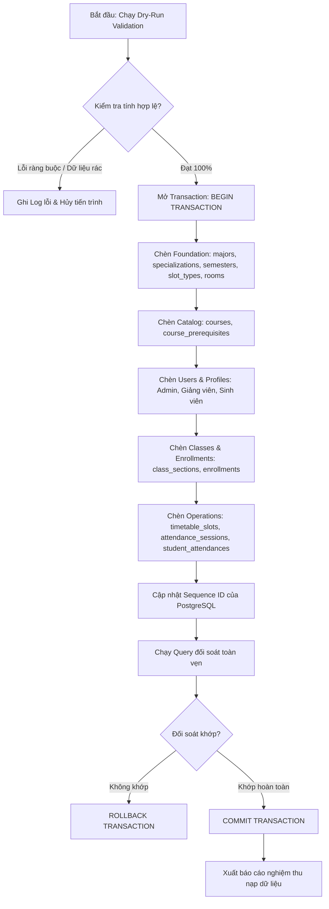

# FPT DEMO SEED DATASET SPECIFICATION & IMPORT PLAN

> **Dự án**: UniCheck – Smart Multi-Platform Attendance System  
> **Tài liệu**: Kế hoạch Xây dựng Bộ Dữ liệu Mẫu (Demo Seed Data) & Quy trình Nạp an toàn  
> **Phiên bản**: 1.0.0  
> **Ngày lập**: 29/10/2026  
> **Mục tiêu**: Phục vụ Demo toàn bộ các luồng Web Admin, Web Lecturer, Mobile App Student & AI Service  

---

## 1. TỔNG QUAN & QUY MÔ BỘ DỮ LIỆU MẪU (SYNTHETIC DATASET METRICS)

Để đảm bảo hệ thống có đầy đủ dữ liệu thực tế mô phỏng 100% môi trường Đại học FPT mà không làm lộ thông tin cá nhân, bộ seed data được thiết kế với quy mô:

| STT | Bảng mục tiêu (Target Table) | Số lượng bản ghi dự kiến | Ghi chú & Nguồn gốc |
|:---:|:---|:---:|:---|
| **1** | `majors` | **5** | CNTT, QTKD, CNTT, Ngôn ngữ, Luật |
| **2** | `specializations` | **10** | Kỹ thuật phần mềm (SE), AI, IA, IS, GD, Marketing, IB... |
| **3** | `courses` | **25** | `PRF192`, `PRO192`, `CSD201`, `DBI202`, `SWE201c`, `SWP391`, `PRJ301`, `PRN211`, `SWT301`, `MAS291`... |
| **4** | `course_prerequisites` | **12** | Cặp tiên quyết logic (ví dụ `PRF192` -> `PRO192` -> `CSD201`) |
| **5** | `semesters` | **3** | `SPRING2026`, `SUMMER2026`, `FALL2026` |
| **6** | `semester_configs` & `slot_types` | **6** | 6 slot/ngày (Slot 1..6 từ 07:30 đến 17:40) |
| **7** | `rooms` | **16** | 4 phòng/tòa tại 4 tòa nhà Campus Hòa Lạc (Alpha, Beta, Gamma, Delta) |
| **8** | `wifi_access_points` | **8** | BSSID giả lập chuẩn cho các tầng và giảng đường |
| **9** | `users` (Admin) | **2** | Quản trị viên hệ thống (`admin`, `staff_daotao`) |
| **10** | `users` (Lecturers) | **8** | Giảng viên bộ môn (`SonNT`, `DungLNT`, `TuanVM`, `KhanhKT`, `ChungLQ`...) |
| **11** | `users` (Students) | **60** | Sinh viên K18, K19 (`HE180001` đến `HE180060`) |
| **12** | `student_profiles` & `lecturer_profiles` | **68** | Thông tin chuyên ngành, GPA, bộ môn công tác |
| **13** | `class_sections` | **8** | 8 lớp học phần (ví dụ `SE1801-PRJ301`, `SE1802-CSD201`, `AI1801-AIL101`...) |
| **14** | `enrollments` | **200** | Trung bình 25 sinh viên / lớp học phần |
| **15** | `timetable_slots` | **120** | Lịch học tuần 4 tuần đầu kỳ Fall 2026 (Thứ Hai đến Thứ Bảy) |
| **16** | `attendance_sessions` | **40** | 30 phiên đã kết thúc (CLOSED), 2 phiên đang mở (OPEN), 8 phiên chuẩn bị (CREATED) |
| **17** | `student_attendances` | **800** | Bản ghi điểm danh thực tế (tỷ lệ: 88% PRESENT, 8% ABSENT, 4% LATE) |

---

## 2. QUY TRÌNH NẠP DỮ LIỆU AN TOÀN (SAFE IMPORT PIPELINE)



---

## 3. THIẾT KẾ MẪU DỮ LIỆU KHÓA (IDEMPOTENT SQL PATTERN)

Mọi câu lệnh nạp đều áp dụng nguyên tắc **Idempotent** (chạy lại nhiều lần không sinh bản ghi thừa và không ném exception):

### 3.1. Nạp Danh mục Môn học (`courses`)
```sql
INSERT INTO courses (code, name, description, credits, number_of_slots, status, is_calculated_in_gpa)
VALUES
('PRF192', 'Programming Fundamentals', 'Nhập môn lập trình tư duy logic với ngôn ngữ C/C++', 3, 30, 'ACTIVE', TRUE),
('PRO192', 'Object-Oriented Programming', 'Lập trình hướng đối tượng chuyên sâu với ngôn ngữ Java', 3, 30, 'ACTIVE', TRUE),
('CSD201', 'Data Structures and Algorithms', 'Cấu trúc dữ liệu và giải thuật căn bản & nâng cao', 3, 30, 'ACTIVE', TRUE),
('DBI202', 'Introduction to Databases', 'Cơ sở dữ liệu quan hệ, SQL và chuẩn hóa dữ liệu', 3, 30, 'ACTIVE', TRUE),
('SWP391', 'Software Development Project', 'Đồ án phát triển phần mềm theo mô hình Agile/Scrum', 3, 30, 'ACTIVE', TRUE),
('PRJ301', 'Java Web Application', 'Phát triển ứng dụng Web Servlet/JSP và Spring framework', 3, 30, 'ACTIVE', TRUE)
ON CONFLICT (code) DO NOTHING;
```

### 3.2. Nạp Người dùng giả lập (`users`)
```sql
-- Mật khẩu mặc định: Password@123 (BCrypt hash $2a$10$abcdef...)
INSERT INTO users (code, username, password, full_name, email, sex, role, status, face_data_status)
VALUES
('ADM001', 'admin', '$2a$10$92IXUNpkjO0rOQ5byMi.Ye4oKoEa3Ro9llC/.og/at2.uheWG/igi', 'Quản Trị Viên Hệ Thống', 'admin@unicheck.edu.vn', 'OTHER', 'ADMIN', 'ACTIVE', 'NOT_REGISTERED'),
('SonNT', 'gv_sonnt', '$2a$10$92IXUNpkjO0rOQ5byMi.Ye4oKoEa3Ro9llC/.og/at2.uheWG/igi', 'Nguyễn Tấn Sơn', 'sonnt@fpt.edu.vn', 'MALE', 'LECTURER', 'ACTIVE', 'NOT_REGISTERED'),
('DungLNT', 'gv_dunglnt', '$2a$10$92IXUNpkjO0rOQ5byMi.Ye4oKoEa3Ro9llC/.og/at2.uheWG/igi', 'Lê Ngọc Tuấn Dũng', 'dunglnt@fpt.edu.vn', 'MALE', 'LECTURER', 'ACTIVE', 'NOT_REGISTERED'),
('HE180001', 'sv_he180001', '$2a$10$92IXUNpkjO0rOQ5byMi.Ye4oKoEa3Ro9llC/.og/at2.uheWG/igi', 'Trần Bảo Long', 'longtbhe180001@fpt.edu.vn', 'MALE', 'STUDENT', 'ACTIVE', 'REGISTERED')
ON CONFLICT (username) DO NOTHING;
```

### 3.3. Cập nhật lại Sequence ID sau nạp
```sql
SELECT setval('courses_id_seq', COALESCE((SELECT MAX(id) FROM courses), 1));
SELECT setval('users_id_seq', COALESCE((SELECT MAX(id) FROM users), 1));
SELECT setval('timetable_slots_id_seq', COALESCE((SELECT MAX(id) FROM timetable_slots), 1));
SELECT setval('attendance_sessions_id_seq', COALESCE((SELECT MAX(id) FROM attendance_sessions), 1));
SELECT setval('student_attendances_id_seq', COALESCE((SELECT MAX(id) FROM student_attendances), 1));
```

---

## 4. QUY TẮC BẢO MẬT & ĐẠO ĐỨC DỮ LIỆU (SYNTHETIC MOCK POLICY)

1. **Gắn nhãn định danh**: Tất cả dữ liệu giả lập được tạo ra đều có `note` hoặc trường mô tả chứa chữ ký `[SYNTHETIC-DEMO-FPTU]`.
2. **Không sử dụng số điện thoại thật**: Số điện thoại sinh viên mẫu tuân theo dải số thử nghiệm được quy định tại Việt Nam (ví dụ `0900000001` đến `0900000099`).
3. **Ảnh khuôn mặt mẫu**: Đối với tính năng điểm danh nhận diện khuôn mặt (Face Recognition), hệ thống sử dụng các mẫu ảnh chân dung AI bản quyền tự do (Creative Commons / AI-generated faces không thuộc về cá nhân nào) để nhúng vector vào bảng `face_encodings`.
