# 🧹 BÁO CÁO DỌN SẠCH DỮ LIỆU DEMO (UNICHECK DEMO DATA RESET REPORT)

**Hệ thống:** UniCheck - Hệ thống Điểm danh Thông minh Đa nền tảng  
**Môi trường:** Development / Demo (Docker Compose, PostgreSQL 15 `unicheck_db`)  
**Thời gian thực hiện:** 10/11/2026 - 13:17:13 (UTC+7)  
**Trạng thái:** ✅ **RESET THÀNH CÔNG – MÔI TRƯỜNG HOÀN TOÀN SẠCH DỮ LIỆU NGHIỆP VỤ**

---

## 1. MÔI TRƯỜNG & DATABASE ĐƯỢC XÁC THỰC

Trước khi thực hiện, hệ thống đã kiểm tra độc lập và xác nhận:
- **Docker Compose Stack:**
  - Container DB: `unicheck_postgres` (PostgreSQL 15-alpine)
  - Container Backend: `unicheck_backend` (Spring Boot 3.3.4, profile `dev`)
  - Container Cache: `unicheck_redis` (Redis 7-alpine)
  - Container AI: `unicheck_ai_service` (Python Flask / Gunicorn)
  - Container Frontend: `unicheck_frontend` (Vite Dev Server port 80)
- **Database Target:** `unicheck_db` (User: `unicheck_user`).
- **Xác nhận môi trường:** Hoàn toàn là môi trường **Development/Demo** nội bộ, không có bất kỳ kết nối nào tới cơ sở dữ liệu Production.

---

## 2. VỊ TRÍ BẢN SAO LƯU (DATABASE BACKUP)

Bản sao lưu toàn vẹn của database trước khi xóa được tạo tự động bằng lệnh `pg_dump`:

- **Đường dẫn tệp sao lưu:**  
  [`backend/backups/unicheck_db_pre_clean_reset_backup_20261110_1314.sql`](file:///c:/Users/Admin/Documents/Antigravity/UniCheck/backend/backups/unicheck_db_pre_clean_reset_backup_20261110_1314.sql)
- **Dung lượng:** 729.670 bytes (~730 KB)
- **Thời điểm tạo:** 10/11/2026 13:14:00 (UTC+7)
- **Tính toàn vẹn:** Đầy đủ schema, flyway history, users, catalog môn học, phòng học, Wi-Fi APs và dữ liệu sinh trắc học Face-ID.

---

## 3. DANH SÁCH BẢNG ĐÃ DỌN & SỐ BẢN GHI TRƯỚC / SAU RESET

Thao tác xóa được thực hiện thông qua script an toàn [`backend/scripts/clean_reset_demo_data.sql`](file:///c:/Users/Admin/Documents/Antigravity/UniCheck/backend/scripts/clean_reset_demo_data.sql) chạy trong một ACID Transaction duy nhất (`BEGIN ... COMMIT`), tuần tự theo chiều phụ thuộc Foreign Key, **tuyệt đối không dùng TRUNCATE CASCADE hay DROP DATABASE**:

```mermaid
flowchart TD
    subgraph Cleared_Operational_Data ["Dữ liệu nghiệp vụ đã dọn sạch (0 bản ghi)"]
        direction TB
        A["attendance_verification_attempts (0 -> 0)"]
        B["attendance_recheck_requests (2 -> 0)"]
        C["attendance_adjustment_histories (4 -> 0)"]
        D["student_attendances (1 -> 0)"]
        E["attendance_sessions (2 -> 0)"]
        F["timetable_slots (2 -> 0)"]
        G["enrollments (1 -> 0)"]
        H["teaching_assignments (1 -> 0)"]
        I["class_sections (1 -> 0)"]
    end

    subgraph Preserved_Foundation_Data ["Dữ liệu nền tảng giữ nguyên 100%"]
        direction TB
        U["users (72 tài khoản)"]
        FE["face_encodings (2 vector ArcFace 512-dim)"]
        CORS["courses (26 môn học)"]
        SEMS["semesters (3 học kỳ)"]
        RMS["rooms (17 phòng học)"]
        WIFI["wifi_access_points (9 APs)"]
        RWIFI["room_wifi_access_points (9 bản ghi)"]
        CFG["attendance_configs (1 cấu hình hệ thống)"]
    end
```



### Thống kê chi tiết từng bảng:

| Bảng dữ liệu | Trước Reset | Sau Reset | Phân loại | Ghi chú xử lý |
| :--- | :---: | :---: | :---: | :--- |
| **`attendance_verification_attempts`** | 0 | **0** | Nghiệp vụ | Xóa vết thử check-in cũ, reset sequence về 1 |
| **`attendance_recheck_requests`** | 2 | **0** | Nghiệp vụ | Xóa yêu cầu re-check cũ, reset sequence về 1 |
| **`attendance_adjustment_histories`** | 4 | **0** | Nghiệp vụ | Xóa lịch sử điều chỉnh điểm danh, reset sequence về 1 |
| **`student_attendances`** | 1 | **0** | Nghiệp vụ | Xóa bản ghi điểm danh ca cũ, reset sequence về 1 |
| **`attendance_sessions`** | 2 | **0** | Nghiệp vụ | Xóa các phiên ca học cũ, reset sequence về 1 |
| **`schedule_requests`** | 0 | **0** | Nghiệp vụ | Trống sẵn, bảo toàn schema |
| **`assignments` & `assignment_submissions`** | 0 | **0** | Nghiệp vụ | Trống sẵn, bảo toàn schema |
| **`chat_groups` & `chat_messages`** | 0 | **0** | Nghiệp vụ | Trống sẵn, bảo toàn schema |
| **`academic_requests`** | 0 | **0** | Nghiệp vụ | Dọn sạch các yêu cầu gắn với lớp học phần cũ |
| **`timetable_slots`** | 2 | **0** | Nghiệp vụ | Xóa 2 slot (slot 136 & 137), reset sequence về 1 |
| **`enrollments`** | 1 | **0** | Nghiệp vụ | Xóa ghi danh của SV vào lớp SE1801-PRJ301, reset sequence về 1 |
| **`teaching_assignments`** | 1 | **0** | Nghiệp vụ | Xóa phân công môn của lớp cũ, reset sequence về 1 |
| **`class_sections`** | 1 | **0** | Nghiệp vụ | Xóa lớp học phần `SE1801-PRJ301` |
| **`users`** | 72 | **72** | **Nền tảng** | **GIỮ NGUYÊN:** Admin, 6 Giảng viên, Sinh viên test |
| **`face_encodings`** | 2 | **2** | **Nền tảng** | **GIỮ NGUYÊN:** Vector khuôn mặt của `sv_he180001` & `student_test` |
| **`courses`** | 26 | **26** | **Nền tảng** | **GIỮ NGUYÊN:** Danh mục 26 môn học (PRJ301, CSD201, SWP391...) |
| **`semesters`** | 3 | **3** | **Nền tảng** | **GIỮ NGUYÊN:** FALL2026, SUMMER2026, SPRING2026 |
| **`rooms`** | 17 | **17** | **Nền tảng** | **GIỮ NGUYÊN:** Danh mục 17 phòng học (AL-L201, BE-L101...) |
| **`wifi_access_points`** | 9 | **9** | **Nền tảng** | **GIỮ NGUYÊN:** Cấu hình SSID/BSSID Access Point |
| **`room_wifi_access_points`** | 9 | **9** | **Nền tảng** | **GIỮ NGUYÊN:** Liên kết phòng học - AP |
| **`attendance_configs`** | 1 | **1** | **Nền tảng** | **GIỮ NGUYÊN:** Cấu hình thời hạn, Wi-Fi, Face-ID mặc định |
| **`flyway_schema_history`** | 10 | **10** | **Nền tảng** | **GIỮ NGUYÊN:** Toàn bộ 10 migration từ V1 đến V10 |
| **Redis In-Memory Cache** | N/A | **FLUSHED** | Cache | Đã `FLUSHDB` toàn bộ token Dynamic QR, session cache, rate-limits |

---

## 4. KIỂM TRA CƠ CHẾ AUTO-SEED (KHÔNG TỰ ĐỘNG SINH LẠI DỮ LIỆU CŨ)

Đã rà soát chi tiết toàn bộ các thành phần có thể tự động tạo dữ liệu:
1. **Spring Boot Source Code:**
   - Không có bất kỳ bean nào triển khai `CommandLineRunner`, `ApplicationRunner`, `InitializingBean`, hay `@EventListener(ApplicationReadyEvent.class)`.
   - Không có phương thức `@PostConstruct` nào chèn dữ liệu vào bảng `class_sections` hoặc `timetable_slots`.
2. **Spring Boot Resources:**
   - Không có tệp `data.sql` hay `import.sql`.
   - Trong `db/migration/`: Không có lệnh `INSERT INTO class_sections` hay `timetable_slots` nào. Toàn bộ migration chỉ định nghĩa DDL và 1 bản ghi cấu hình mặc định trong V7.
3. **Docker Compose & Entrypoint:**
   - PostgreSQL container không gắn thư mục `docker-entrypoint-initdb.d`. Dữ liệu chỉ nằm trong volume persistent.
4. **Seed Scripts cũ:**
   - File [`backend/scripts/setup_clean_demo_schedule.sql`](file:///c:/Users/Admin/Documents/Antigravity/UniCheck/backend/scripts/setup_clean_demo_schedule.sql) chỉ là script thủ công được lưu trữ, không liên kết với build pipeline hay CI/CD.
5. **Frontend Web & Mobile App:**
   - Không có hardcode hay mock data nào tự sinh lớp học trong `mobile/lib/` hay `frontend/src/`. Mọi dữ liệu đều fetch 100% qua REST API của Backend.
6. **Thực nghiệm khởi động lại (Restart Test):**
   - Đã thực hiện `docker restart unicheck_backend`. Backend khởi động trong 12.64s.
   - Truy vấn database ngay sau khi restart: **Số lượng lớp học phần = 0, Lịch học = 0, Phiên điểm danh = 0**. Hoàn toàn không bị sinh lại dữ liệu!

---

## 5. KẾT QUẢ ĐỒNG BỘ TRÊN CÁC GIAO DIỆN (API VERIFICATION)

Đã gọi kiểm tra trực tiếp qua API với từng vai trò:

### 5.1. Admin Web (`admin` / `Admin@123`)
- `GET /api/v1/classes?page=0&size=10`: **`totalElements = 0`** (Không còn lớp học phần cũ).
- `GET /api/v1/timetable/slots`: **`content.length = 0`** (Thời khóa biểu hoàn toàn sạch).
- `GET /api/v1/courses`: Trả về danh sách **26 môn học** đầy đủ để Admin chọn khi tạo lớp.
- `GET /api/v1/facilities/rooms`: Trả về danh sách **17 phòng học** đầy đủ để Admin xếp lịch.
- `GET /api/v1/timetable/available-rooms`: Logic lọc phòng trống thời gian thực hoạt động tốt (tất cả các phòng đều đang khả dụng).

### 5.2. Lecturer Web (`gv_sonnt` / `Password@123`)
- `GET /api/v1/attendance/sessions`: **`totalElements = 0`** (Không còn phiên cũ).
- `GET /api/v1/timetable/me`: **`data.length = 0`** (Lịch giảng dạy trống sạch sẽ).
- Sau khi Admin tạo lớp và phân công, giảng viên sẽ thấy lịch ngay lập tức.

### 5.3. Student Mobile Flutter (`sv_he180001` / `Password@123`)
- Đăng nhập xác thực JWT thành công.
- `GET /api/v1/timetable/me`: **`data.length = 0`** (Thời khóa biểu tuần trống).
- `GET /api/v1/attendance/recheck-requests/pending`: **`data.length = 0`** (Không còn banner cảnh báo re-check cũ).
- FaceID đã đăng ký (vector 512-dim ArcFace) vẫn được bảo toàn nguyên vẹn trong `face_encodings` sẵn sàng cho việc nhận diện khi được ghi danh vào lớp mới.

---

## 6. HƯỚNG DẪN BẮT ĐẦU KỊCH BẢN DEMO MỚI TỪ ĐẦU (STEP-BY-STEP DEMO FLOW)

Hệ thống hiện tại đã sẵn sàng để người dùng tự thao tác từ đầu trên giao diện:

### Bước 1: Admin tạo Lớp học phần mới
- Đăng nhập Web Admin: `http://localhost` (hoặc `http://localhost:5173/login`) với tài khoản `admin` / `Admin@123`.
- Vào mục **Quản lý Lớp học phần** (`/admin/classes`).
- Nhấn **Tạo lớp học phần mới**:
  - Mã lớp: `SE1801-PRJ301` (hoặc mã tùy chọn).
  - Chọn môn học: `PRJ301 - Java Web Application Development`.
  - Chọn học kỳ: `Fall 2026`.
  - Chọn giảng viên: `Nguyễn Tấn Sơn` (`gv_sonnt`).
  - Số lượng sinh viên tối đa: `30`.

### Bước 2: Admin ghi danh sinh viên vào lớp
- Trên dòng lớp học phần vừa tạo, nhấn nút **Quản lý sinh viên / Ghi danh**.
- Ghi danh sinh viên: `Bùi Thị An` (Mã SV: `HE180001`, username: `sv_he180001`).

### Bước 3: Admin xếp lịch học (Thời khóa biểu)
- Vào mục **Thời khóa biểu** (`/admin/timetable`).
- Nhấn **Thêm tiết học / Lịch giảng mới**:
  - Chọn lớp: Lớp vừa tạo.
  - Chọn giảng viên: `Nguyễn Tấn Sơn`.
  - Ngày học: Ngày hôm nay (ví dụ: `10/11/2026`).
  - Tiết học: Chọn ca học (Dropdown phòng học tự động gọi Backend kiểm tra phòng trống).
  - Chọn phòng: `AL-L201`.

### Bước 4: Giảng viên mở phiên điểm danh & chiếu Dynamic QR
- Đăng nhập Web Giảng viên với tài khoản `gv_sonnt` / `Password@123`.
- Vào mục **Phiên điểm danh** (`/lecturer/attendance-session`). Ca học vừa tạo sẽ hiển thị với trạng thái `CREATED`.
- Nhấn **Mở phiên**: Chọn thời gian đổi mã QR (mặc định 10s hoặc tùy chỉnh).
- Nhấn **Chiếu mã QR xoay vòng**: Mã Dynamic QR sẽ tự động thay đổi theo chu kỳ.

### Bước 5: Sinh viên thực hiện điểm danh trên Flutter Mobile
- Mở ứng dụng Flutter Mobile (hoặc Android Emulator Pixel 10 Pro).
- Đăng nhập tài khoản `sv_he180001` / `Password@123`.
- Trên Dashboard / Thời khóa biểu: Ca học đang diễn ra sẽ hiển thị nút **"Điểm danh ngay"**.
- Nhấn nút -> Quét mã Dynamic QR từ màn hình Giảng viên.
- Màn hình Kiểm tra 5 điều kiện (Mạng Wi-Fi, GPS, Ghi danh, Ca học, Trạng thái phiên) đạt màu xanh.
- Chuyển tiếp tới **Face-ID Check-in** -> Camera nhận diện khuôn mặt sinh viên, AI Liveness (MiniFASNet) + ArcFace (độ tương đồng >= 0.68) xác thực -> Báo điểm danh thành công kèm mã biên nhận `#ATT-...`.

### Bước 6: Giảng viên kiểm tra & Thử tính năng Điểm danh lại (Re-Check-In)
- Trên Web Giảng viên: Danh sách check-in nhảy số ngay lập tức (1/1 sinh viên, 100% chuyên cần).
- Giảng viên nhấn nút **"Quản lý SV & Re-check"**:
  - Có thể sửa thủ công (chuyển sang `ABSENT` hoặc `LATE` có nhập lý do).
  - Hoặc nhấn **"Yêu cầu quét lại"** (chọn thời hạn 15 phút, nhập lý do).
- Trên Flutter Mobile của sinh viên: Xuất hiện ngay Alert Card màu cam thông báo giảng viên yêu cầu điểm danh lại.
- Sinh viên nhấn **"Điểm danh lại ngay"** để thực hiện lại chu trình xác thực hoàn chỉnh.

---

## 7. CÁCH THỨC KHÔI PHỤC DỮ LIỆU (NẾU CẦN)

Nếu muốn khôi phục lại dữ liệu demo của phiên trước, chạy lệnh duy nhất sau tại terminal:
```bash
docker exec -i unicheck_postgres psql -U unicheck_user -d unicheck_db < backend/backups/unicheck_db_pre_clean_reset_backup_20261110_1314.sql
docker restart unicheck_backend
```

---
*Báo cáo được hoàn tất bởi Antigravity Engineering Assistant.*
